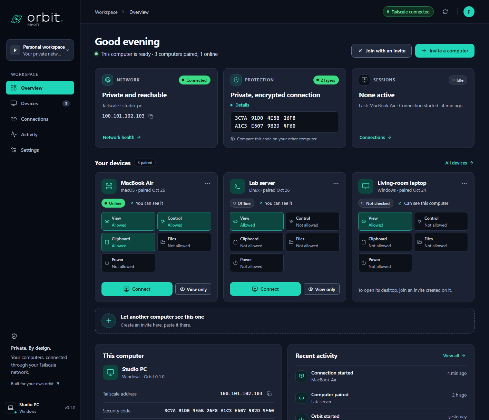
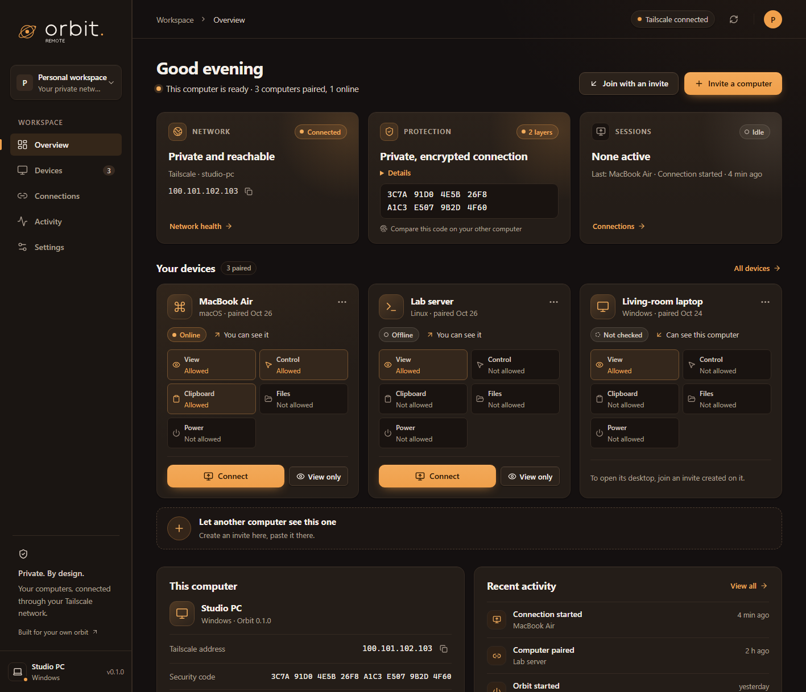
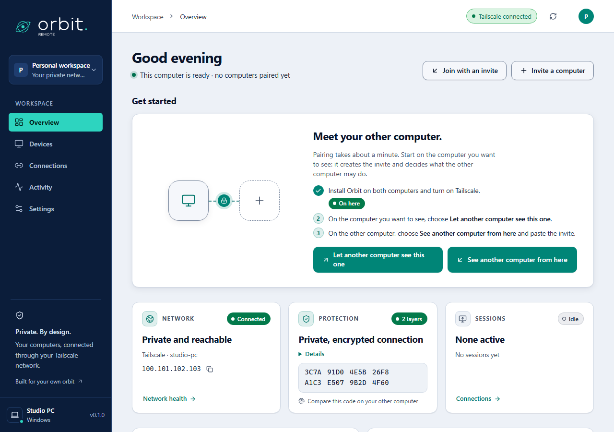
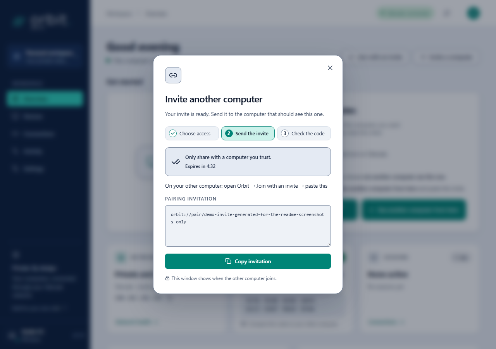
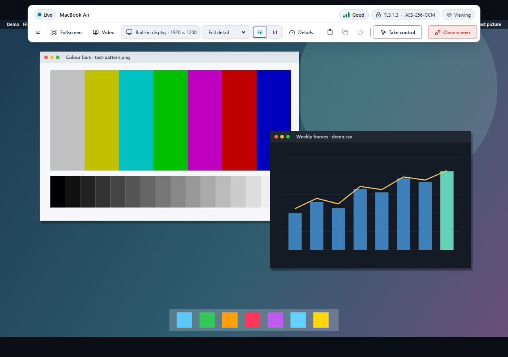
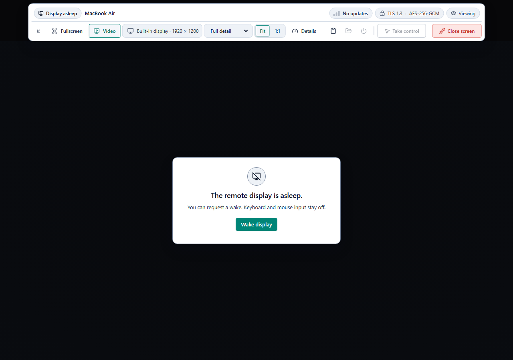
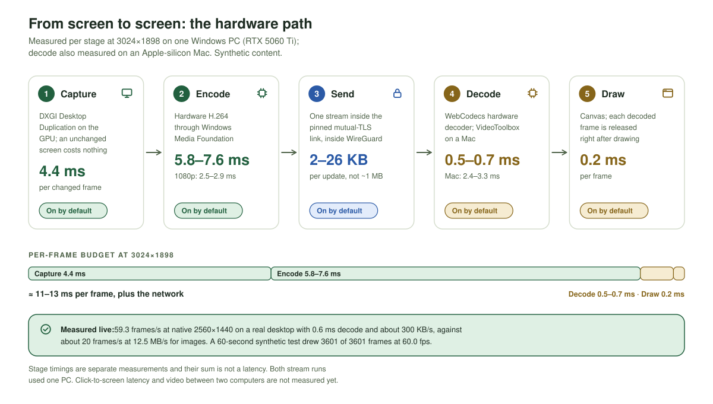

<div align="center">
  <picture>
    <source media="(prefers-color-scheme: dark)" srcset="docs/assets/brand/logo.svg">
    
  </picture>
  <h1>Your world. Within reach.</h1>
  <p><strong>Private remote desktop between your own computers, over Tailscale.</strong></p>
  <p>See another computer's screen, and control it only if its owner allowed that. Every connection uses mutual TLS inside Tailscale's WireGuard. Remove a computer's access at any time.</p>
  <p>
    <a href="docs/VALIDATION.md"></a>
    <a href="https://github.com/Optimizer077/orbit-remote/releases/tag/v0.1.0-preview.6"></a>
    <a href="docs/ARCHITECTURE.md"></a>
    <a href="docs/ENCRYPTION.md"></a>
    <a href="docs/ENCRYPTION.md"></a>
    <a href="#performance"></a>
    <a href="docs/MACOS.md"></a>
  </p>
  <p>
    <a href="https://github.com/Optimizer077/orbit-remote/releases/tag/v0.1.0-preview.6"><strong>Download Windows</strong></a> ·
    <a href="docs/MACOS.md">Continue on a Mac</a> ·
    <a href="docs/ARCHITECTURE.md">How it works</a> ·
    <a href="TODO.md">Roadmap</a> ·
    <a href="CONTRIBUTING.md">Contribute</a>
  </p>
</div>

<p align="center">
  <picture>
    <source media="(max-width: 767px) and (prefers-reduced-motion: reduce)" srcset="docs/assets/orbit-flow-narrow-static.svg">
    <source media="(max-width: 767px)" srcset="docs/assets/orbit-flow-narrow.svg">
    <source media="(prefers-reduced-motion: reduce)" srcset="docs/assets/orbit-flow-static.svg">
    
  </picture>
</p>

> **Public development preview, with explicit limits.** Windows has local runtime evidence. A real view-only session between Windows and an Apple-silicon Mac works in both directions. Since preview.5, a Windows computer shares its screen as hardware H.264 video by default (59.3 fps live at 2560×1440 on one PC, still labeled beta in the app) and falls back to images when video can't run. Click-to-screen latency, video between two computers, control across two computers, Intel Macs, and Linux still need measurement or validation. Downloads are unsigned. Access before anyone signs in, and production security, are not established.

Orbit Remote is a desktop app for people who want to reach **their own** Windows, macOS, and Linux computers from each other, or a computer whose owner invited them. Every installation can both see other computers and be seen. It is not built for managing many unattended computers.

**Private by design.** Your computers connect directly over your own [Tailscale](https://tailscale.com) network, and each side proves its identity with a certificate pinned at pairing (mutual TLS). Orbit runs no server and needs no account. It never changes your startup, firewall, or Tailscale settings on its own.

**You choose what the other computer may do.** Another computer can see this one only after it joins an invite you created here. The invite says **See only** or **See and control**, and clipboard, files, and lock & restart are separate switches. This computer checks every request, and **Remove access…** disconnects the other computer at once.

**Bolder and smoother.** The default Daylight and Graphite themes now have a solid deep-navy sidebar, a vivid teal accent, and solid status colours, and the test suite checks them against WCAG AA contrast. The viewer shows the newest frame first and skips frames a newer one has already replaced, and **Connection details** says whether video is decoded in hardware or software. The app uses plain words (computer, **Allowed**, **Remove access…**), keyboard focus stays inside dialogs, and notices are announced to screen readers.

<p align="center"></p>

## Contents

**Use Orbit:** [At a glance](#at-a-glance) · [Why Orbit](#why-orbit) · [Get started](#get-started) · [Using Orbit](#using-orbit) · [Themes](#themes) · [FAQ](#faq) · [Platform support](#platform-support)

**How it is built:** [How it works](#how-it-works) · [Security](#security) · [Performance](#performance) · [Project status](#project-status) · [Develop](#develop) · [Documentation](#documentation) · [Contributing](#contributing)

## At a glance

| **Private by design** | **Encrypted twice** | **Trust you can check** |
|---|---|---|
| No Orbit server, account, or relay. Your computers reach each other directly over your own Tailscale network. | Tailscale's WireGuard outside, Orbit's mutual TLS 1.3 inside. Both sides refuse weaker encryption. | Invites that work once, pinned certificates, and a security code you compare once by eye. |
| **You decide what's allowed** | **Honest status** | **One app, three systems** |
| Seeing the screen, mouse & keyboard, clipboard, files, and lock & restart are allowed separately. The computer being seen checks every request, and you can remove access at any time. | The viewer shows the encryption actually in use. Unsupported states are labeled, never faked. | Windows x64 is exercised today, and Windows on ARM builds from source. Apple-silicon Macs are tested with Windows. Linux awaits testing on real hardware. |
| **Hardware-accelerated** | **Light on the network** | **Fails safe** |
| GPU capture, hardware H.264 and hardware decode, on by default when a Windows computer shares its screen: 59.3 fps at native 2560×1440, measured live on one PC. | About 300 KB/s for a live 1440p screen, against 12.5 MB/s for full images. An idle screen sends almost nothing. | If video can't run, Orbit falls back to images. Removing a computer's access disconnects it at once. |

## Why Orbit

You have a few computers and want to reach them from each other, without handing your screen to a third party or opening a door to the internet. The usual options each give something up:

| Usual approach | What you give up | What Orbit does instead |
|---|---|---|
| Cloud remote-desktop services | An account and a vendor's broker sit between your computers. | No Orbit server or account. Computers connect directly over **your own** Tailscale network. |
| RDP/VNC ports open to the internet or LAN | An exposed login screen anyone on the network can attack. | Listens only on its Tailscale address, and every computer that connects must hold a certificate you paired explicitly. |
| VPN + RDP | Usually one OS, and all-or-nothing desktop access. | One app for Windows, macOS, and Linux, with **separate permissions** for the screen, mouse & keyboard, clipboard, files, and lock & restart. |
| "Trust us, it's encrypted" | You can't see what protects you. | **Two encryption layers** you can inspect: the encryption in use is shown live, and a security code confirms each pairing. |

Orbit is for reaching your own computers, or ones whose owner explicitly invited you. It is not built for managing many unattended computers, or for access before anyone has signed in.

## Get started

### Download for Windows

Get the [preview release](https://github.com/Optimizer077/orbit-remote/releases/tag/v0.1.0-preview.6):

| Download | Use it when |
|---|---|
| `Orbit-Remote-Setup-0.1.0-x64.exe` | You want Orbit installed for your Windows user, with a Start menu shortcut. |
| `Orbit-Remote-Portable-0.1.0-x64.exe` | You want to run one EXE without installing. |
| `SHA256SUMS.txt` | You want to check the download's SHA-256 checksum. |

These are **unsigned preview builds**, without independent security review or full testing on real hardware. Changes since this release are listed in the [changelog](CHANGELOG.md#unreleased).

<details>
<summary>Install notes</summary>

Both EXEs include Orbit's background service and the .NET runtime. You need Tailscale installed and signed in, but not Node.js or the .NET SDK. The installer doesn't turn on startup at sign-in, change firewall or Tailscale settings, or open Orbit when it finishes. The portable app saves its settings and identity in the normal per-user application-data folder. **Start Orbit at sign-in** is available only in the installed app. Uninstalling keeps your local profile, so pairing keys are never silently deleted.

</details>

### Pair two computers

Pairing happens once per direction. Start on the computer you want to see: it creates the invite and decides what the other computer may do.

1. Install Orbit on both computers, and turn on Tailscale on both. In your Tailscale access rules, allow only the computers you intend, on TCP port **47832**.
2. On the computer you want to see, choose **Invite a computer**. On first run, this button reads **Let another computer see this one**.
3. Choose **See only** (the default) or **See and control**. Under **More access (optional)**, turn on **Clipboard**, **File transfer**, or **Lock & restart** only if you need them. Then choose **Create invite**.
4. Choose **Copy invitation** and send it privately to the other computer. The invite works once and expires after five minutes; the dialog counts down.
5. On the other computer, choose **Join with an invite** (on first run: **See another computer from here**), paste the invite, and choose **Pair this computer**.
6. **Compare the security code once.** After joining, the dialog shows the other computer's security code. It must match the code under **Overview → This computer** on the computer that created the invite. You can find it again later in that computer's **⋯** menu.
7. Choose **Connect now**, or **Later**. Pairing alone never connects.

To see the computers the other way round, create an invite on the second computer and join it from the first.

### Build on macOS or Linux

Install Git, Node.js 24 LTS, the .NET 10 SDK matching `global.json`, and Tailscale. Then:

```bash
git clone https://github.com/Optimizer077/orbit-remote.git
cd orbit-remote
bash scripts/start-dev.sh          # development run
bash scripts/build.sh --package    # native package (DMG on macOS)
```

The script detects Apple silicon or Intel and builds a matching package. Read [the Mac guide](docs/MACOS.md) for privacy permissions and first tests between two computers. Compiling on a Mac does not by itself show that Mac support works.

## Using Orbit

### See and control another computer

- **Connect** opens the other computer's desktop so you can see it and, if allowed, control it. **View only** opens it without mouse or keyboard.
- **Take control** sends your mouse and keyboard to the other computer. It works only if that computer's owner chose **See and control**. While you control it, the button reads **Control enabled**; choose it again to give control back.
- While you control the other computer, **Esc**, **F11** and ordinary shortcuts go to it. **Ctrl+Alt+Enter** toggles fullscreen and brings back Orbit's own controls.
- The viewer offers **Fit** and **1:1**, fullscreen, **Open screen in window** for the other computer's other displays, and **Details** for smoothness, late frames, decode time and encryption.
- **Clipboard**, **Files**, and lock and restart in the toolbar work only when the invite allowed them.

### Stop someone from seeing this computer

- While another computer is connected, a banner on this computer offers **End session** (or **Disconnect all** when several are connected). The computer then shows **Disconnected by you** and can't connect again until you choose **Allow again**.
- To take away access for good, open the computer's **⋯** menu and choose **Remove access…**. It is disconnected at once and needs a new invite to come back.
- **Forget…** in the same menu removes a computer *you* can see from your list and ends any connection to it. It does not change the access set on that computer.
- The tray menu offers **Disconnect all incoming sessions** and **Quit Orbit and stop remote access**.

### Pages

| Page | What it shows |
|---|---|
| **Overview** | Your paired computers, this computer's Tailscale address and security code, network and protection status, and recent activity. |
| **Devices** | Every paired computer: **You can see it** or **Can see this computer**, online state, and what each one is allowed to do. **Check availability** asks each one whether it is online. |
| **Connections** | The open connection, the computers you can see, and the computers that can see this one. |
| **Activity** | What happened on this computer: connections, pairings, removed access, file transfers, and setting changes. |
| **Settings** | Appearance, this computer's name and security code, remote access, startup, network health, and identity. |

Press **Ctrl+K** (**⌘K** on a Mac) for the command palette: jump to a page, connect, pair, or change the theme.

### Settings

| Section | What you can change |
|---|---|
| **Appearance** | Pick one of five themes, or **Follow your system**. |
| **This computer** | The name other computers see, and this computer's security code with **Copy security code**. |
| **Remote access** | **File transfer** (asks you to choose one shared folder) and **Lock & restart**. Both are off until you turn them on. Remote mouse & keyboard and clipboard are set in each invite instead. An action works only when it is on here and also allowed in that computer's invite. |
| **Stay within reach** | **Start Orbit at sign-in**, in the installed Windows and macOS app. Someone still has to sign in first. |
| **Network health** | Whether Tailscale is detected, with this computer's Tailscale address, name, and Orbit's port. |
| **This computer's identity** | When it expires, and **Replace identity…**. After replacing it, every computer must pair again. See [identity expiry and recovery](docs/IDENTITY-RECOVERY.md). |

### What you get today

| Area | Details |
|---|---|
| **Video** | Hardware H.264 video when a Windows computer shares its screen, on by default: GPU capture, low-latency hardware encoding, and hardware decoding in the viewer. Images when video can't run. |
| **Viewer** | Full-window viewer, native fullscreen, extra windows for other displays, a smoothness meter, and a cursor drawn locally. Keyboard focus is visible, and reconnects are announced to screen readers. |
| **When the other computer changes** | If its display is asleep, the viewer says **Display asleep** instead of showing a frozen picture, releases held keys, and checks again every few seconds. With control allowed you can press **Wake display** (at most once every 5 s; not in View only). Updates pause while the window is minimized, and **Reconnect** is one click after the other computer's Orbit restarts. |
| **Sharing** | Many viewers at once, one in control at a time. A connection ended on this computer is never resumed automatically. |
| **Clipboard & files** | Text clipboard on request only, never automatic. Files go through one shared folder you choose, with no overwrite and up to 32 MiB per transfer. Received files are marked as downloaded from the internet. |
| **Errors** | Common problems, such as an expired invite, Tailscale being off, or clocks that disagree, get a plain title and one next step. The original error stays under **Details**. |

Audio is not implemented.

## Themes

Pick a theme in **Settings** or with the command palette (**Ctrl/⌘ K**). By default Orbit follows your system: **Daylight** in light mode, **Graphite** in dark mode.

| Daylight | Graphite |
|:---:|:---:|
| <a href="docs/assets/overview.png"></a> | <a href="docs/assets/graphite.png"></a> |
| **Midnight** | **Paper** |
| <a href="docs/assets/midnight.png"></a> | <a href="docs/assets/paper.png"></a> |
| **Ember** | |
| <a href="docs/assets/ember.png"></a> | |

Every theme is designed for WCAG AA text contrast, uses no text smaller than 12 px, and respects reduced motion. The [brand guide](docs/BRAND.md) covers the logo, icons, palette, type, and motion.

### A look at the app

Shown in Daylight, or Graphite when your system is in dark mode. Names, addresses, and the remote picture are generated demo content.

| First run: pick a direction | Invite with a live countdown |
|:---:|:---:|
| <picture><source media="(prefers-color-scheme: dark)" srcset="docs/assets/screens/first-run-dark.png"></picture> | <picture><source media="(prefers-color-scheme: dark)" srcset="docs/assets/screens/invite-dark.png"></picture> |
| **Full-window viewer** | **Other computer's display asleep** |
| <picture><source media="(prefers-color-scheme: dark)" srcset="docs/assets/screens/viewer-dark.png"></picture> | <picture><source media="(prefers-color-scheme: dark)" srcset="docs/assets/screens/asleep-dark.png"></picture> |

## FAQ

**My two computers can't find each other.**
Both need Tailscale on and signed in to the same Tailscale network, because Orbit listens only on the Tailscale address. If Tailscale was off when Orbit started, turn it on and choose **Tailscale is on now — check again**.

**Why is Take control greyed out?**
The other computer's owner chose **See only**, or you opened it with **View only**. Ask its owner for a new invite with **See and control**.

**Can I reach a computer that is locked, or that just restarted?**
Not yet. Someone must sign in and unlock it first. **Start Orbit at sign-in** brings Orbit back after that sign-in.

**What happens if an invite leaks?**
It works only once and only for five minutes. If someone else used it first, the security codes won't match, and an unknown computer appears under **Devices**. Choose **Remove access…** for it.

**Does Orbit send anything to a server?**
No. There is no Orbit server or account. Traffic goes directly between your computers over Tailscale.

## Platform support

| Capability | Windows | macOS | Linux |
|---|---|---|---|
| Desktop app | Exercised locally | Exercised on Apple silicon ([Mac record](docs/MACOS-VALIDATION.md)) | Needs native build/test |
| Sharing an unlocked screen | GPU (DXGI) with GDI fallback, exercised | Native helper, exercised with Screen Recording permission (Retina + external display) | X11 + ffmpeg |
| Hardware video | Sending, measured with an NVIDIA GPU | Viewer decode measured; a Mac shares its screen as images | Shares its screen as images |
| Mouse & keyboard | SendInput adapter | CoreGraphics + Accessibility, exercised | X11 + xdotool |
| Text clipboard | Win32 | pbcopy/pbpaste, exercised | X11 + xclip |
| Locked, sign-in, or UAC screen | **Unsupported** | **Unsupported** | **Unsupported** |
| Start Orbit at sign-in | Installed app option | Packaged option, needs validation | Deployment work remains |
| Access before anyone signs in | **Not implemented** | **Not implemented** | **Not implemented** |
| Wayland | N/A | N/A | **Unsupported; fails closed** |

## How it works

The rest of this README uses precise terms. The **host** is the computer being seen; the **viewer** is the computer looking at it. Every installation is both. A **grant** is one permission from the invite, such as Control or Files. To **revoke** a pairing is what the app calls **Remove access…**.

**Your viewer asks; the host decides.** Every request crosses two encryption layers and four checks on the host before it reaches the desktop.

<p align="center">
  <picture>
    <source media="(max-width: 767px) and (prefers-color-scheme: dark)" srcset="docs/assets/diagrams/how-it-works-narrow.svg">
    <source media="(max-width: 767px)" srcset="docs/assets/diagrams/how-it-works-narrow-light.svg">
    <source media="(prefers-color-scheme: dark)" srcset="docs/assets/diagrams/how-it-works.svg">
    
  </picture>
</p>

### What happens when you click Connect

1. **The window asks, the main process acts.** The sandboxed Orbit window can only send allow-listed actions to Orbit's main process. It never sees keys, sockets, or the local control token.
2. **Outbound checks.** The main process accepts only a literal Tailscale IP, offers only strong TLS suites, and presents this computer's certificate.
3. **Nothing goes to an unverified host.** Before a single HTTP byte is sent, the viewer checks the host's certificate against the SHA-256 pin saved at pairing (certificate pinning), and checks that the negotiated encryption meets policy.
4. **The host's four checks.** Tailscale delivers only tailnet traffic to port `47832`. The host then ① drops any link below the TLS policy, ② confirms the source with `tailscale whois` and matches the viewer's certificate to a pairing that has not been revoked, ③ applies that viewer's grants, and ④ opens a session. One viewer controls at a time; others can watch.
5. **Screen updates.** A Windows host captures the chosen monitor on its GPU, encodes hardware H.264, and sends one continuous video stream over the double-encrypted link; the viewer decodes it in hardware. If video can't run, or the host is a Mac or Linux computer, the host sends images instead. The viewer shows the measured encryption, for example `TLS 1.3 · AES-256-GCM · X25519`.
6. **Input needs two yeses.** The owner must have granted control, and you must choose **Take control**. Input is bounded and coalesced, and held keys are released if the viewer disappears.
7. **Ending is final.** Disconnect, **Disconnect all**, or a host stop ends the session with `410`, and the viewer never silently reconnects. Revoking the pairing (`401`) removes its access.

### Architecture, component by component

<p align="center">
  <picture>
    <source media="(max-width: 767px) and (prefers-color-scheme: dark)" srcset="docs/assets/diagrams/architecture-narrow.svg">
    <source media="(max-width: 767px)" srcset="docs/assets/diagrams/architecture-narrow-light.svg">
    <source media="(prefers-color-scheme: dark)" srcset="docs/assets/diagrams/architecture.svg">
    
  </picture>
</p>

Every real component in one picture: the Electron app's sandboxed renderer, preload bridge, and main process (`transport.cjs` checks the pin and TLS policy before any byte; `controller.cjs` runs pairing, sessions, frames, and input), the two encryption layers, and the host's gates, services, stores, and OS adapters. The figure shows five gates because it draws the Tailscale source check and the certificate pin (check ② above) separately. See [the architecture document](docs/ARCHITECTURE.md) for trust boundaries and sequences.

### What runs on each computer

<p align="center">
  <picture>
    <source media="(max-width: 767px) and (prefers-color-scheme: dark)" srcset="docs/assets/diagrams/processes-narrow.svg">
    <source media="(max-width: 767px)" srcset="docs/assets/diagrams/processes-narrow-light.svg">
    <source media="(prefers-color-scheme: dark)" srcset="docs/assets/diagrams/processes.svg">
    
  </picture>
</p>

The Orbit window is sandboxed with no Node.js access. Keys and the local control token stay in the main process and the host. The host has a local admin API on `127.0.0.1:47831` (bearer token) for its own app, and listens remotely only on its verified Tailscale address. There is no public or LAN listener, remote shell, or router port forwarding. Read [the architecture](docs/ARCHITECTURE.md) for trust boundaries and how multiple screen windows share one session.

## Security

### Encrypted in layers

<p align="center">
  <picture>
    <source media="(max-width: 767px) and (prefers-color-scheme: dark)" srcset="docs/assets/diagrams/layers-narrow.svg">
    <source media="(max-width: 767px)" srcset="docs/assets/diagrams/layers-narrow-light.svg">
    <source media="(prefers-color-scheme: dark)" srcset="docs/assets/diagrams/layers.svg">
    
  </picture>
</p>

1. **Network: Tailscale WireGuard.** Only devices on your tailnet (your private Tailscale network) can reach the host. Traffic between them is encrypted with Curve25519 and ChaCha20-Poly1305, including through Tailscale relays.
2. **Application: Orbit mutual TLS, inside that tunnel.** In mutual TLS (mTLS), both computers prove their identity with a certificate. Orbit allows TLS 1.3, or TLS 1.2 with ECDHE + AES-GCM/ChaCha20-Poly1305 only. Every allowed suite has forward secrecy. The viewer offers only those suites, and the host independently drops anything weaker before reading a request.
3. **Identity: pinned certificates.** Each computer has its own RSA-3072 identity. Pins are checked on every connection, so a changed certificate is blocked, and the app says *The other computer's identity changed*.
4. **Access: host permissions.** A verified viewer still gets only the grants the owner chose.
5. **At rest: protected keys.** Identity keys are encrypted with your Windows account (DPAPI). macOS and Linux use user-only files, with native keychains planned.

Measured against the real Windows host: clients offering only CBC or static-RSA suites were *served* before this policy and are *refused* now. See [How Orbit protects your connection](docs/ENCRYPTION.md).

### Pairing and the security code

<p align="center">
  <picture>
    <source media="(max-width: 767px) and (prefers-color-scheme: dark)" srcset="docs/assets/diagrams/pairing-narrow.svg">
    <source media="(max-width: 767px)" srcset="docs/assets/diagrams/pairing-narrow-light.svg">
    <source media="(prefers-color-scheme: dark)" srcset="docs/assets/diagrams/pairing.svg">
    
  </picture>
</p>

The invite carries the host's address, its certificate fingerprint, and a one-time secret. It is valid for five minutes and works once. The viewer verifies the host's certificate **before** revealing the secret. Afterwards both computers show the same eight-group **security code**: compare it once. If someone tampered with the host details in the invite, the codes won't match. If an invite leaks and someone else pairs first, an unknown computer appears among the host's paired computers: revoke it with **Remove access…**.

### What a paired computer can do

<p align="center">
  <picture>
    <source media="(max-width: 767px) and (prefers-color-scheme: dark)" srcset="docs/assets/diagrams/permissions-narrow.svg">
    <source media="(max-width: 767px)" srcset="docs/assets/diagrams/permissions-narrow-light.svg">
    <source media="(prefers-color-scheme: dark)" srcset="docs/assets/diagrams/permissions.svg">
    
  </picture>
</p>

| Grant | In the invite | What it allows | Also needs |
|---|---|---|---|
| **View** | **See only** (the default) | See the chosen screen | Always included |
| **Control** | **See and control** | Mouse and keyboard | **Take control** on the viewer; one controller at a time |
| **Clipboard** | **Clipboard** | Read and write text | Explicit actions only, never automatic sync |
| **Files** | **File transfer** | Send and receive files | **File transfer** on in the host's Settings. One shared folder, no overwrite, 32 MiB per transfer; received files are marked as downloaded from the internet |
| **Power** | **Lock & restart** | Lock or restart | **See and control**, and **Lock & restart** on in the host's Settings |

The host enforces every grant on every request. Grants belong to the pairing: to change them, revoke the pairing and send a new invite. Revoking ends the computer's sessions at once; an open video stream stops within a second.

### Session lifecycle

<p align="center">
  <picture>
    <source media="(max-width: 767px) and (prefers-color-scheme: dark)" srcset="docs/assets/diagrams/lifecycle-narrow.svg">
    <source media="(max-width: 767px)" srcset="docs/assets/diagrams/lifecycle-narrow-light.svg">
    <source media="(prefers-color-scheme: dark)" srcset="docs/assets/diagrams/lifecycle.svg">
    
  </picture>
</p>

- **Paired → Live:** choose **Connect** or **View only**.
- **Live ↔ Controlling:** **Take control** (if granted); choose **Control enabled** to release it.
- **Reconnecting:** after a network drop, the session renews with the same identity, and permissions are rechecked.
- **Ended (`410`):** Disconnect, **Disconnect all**, or a host stop. Never resumed automatically, even after a restart.
- **Revoked (`401`):** the owner chose **Remove access…**; the viewer needs a new invite.

### Reliability and hardening

- The main process supervises the host, shuts it down when the owner app exits, and bounds shutdown and drain times.
- Streams are limited per viewer and per host, and session renewal rechecks identity and grants.
- The installed app can't be run as Node.js, ignores `NODE_OPTIONS` and inspect flags, and loads only from its integrity-checked archive.

### Limits, stated plainly

- It does not protect a compromised computer: malware or an administrator on either end can see what you see.
- It is not post-quantum in practice: the Windows host negotiates classical X25519.
- It has had no independent security audit yet, and the builds are unsigned previews.

Read [SECURITY.md](SECURITY.md) before deployment. Report security concerns privately through the repository's **Security** tab, [Report a vulnerability](https://github.com/Optimizer077/orbit-remote/security/advisories/new); please do not open a public issue with details.

The [October 2026 security review](docs/SECURITY-REVIEW.md) lists every finding, its fix and the limits that remain.

## Performance

A Windows host streams hardware H.264 video by default. It captures the screen on the GPU with DXGI Desktop Duplication, encodes it with the GPU's H.264 encoder through Windows Media Foundation (low-latency mode, no B-frames), and sends one continuous stream inside the pinned mutual-TLS link. The viewer decodes it with WebCodecs, which Chromium backs with D3D11VA on Windows, VideoToolbox on macOS, and VA-API on Linux. If video can't run, the session falls back to images.

<p align="center">
  <picture>
    <source media="(max-width: 767px) and (prefers-color-scheme: dark)" srcset="docs/assets/diagrams/pipeline-narrow.svg">
    <source media="(max-width: 767px)" srcset="docs/assets/diagrams/pipeline-narrow-light.svg">
    <source media="(prefers-color-scheme: dark)" srcset="docs/assets/diagrams/pipeline.svg">
    
  </picture>
</p>

### Measured

Every result comes from one Windows PC with an NVIDIA RTX GPU, except the Mac decode figure. Per-stage timings are medians on synthetic screen content.

| What | Result | How it was measured |
|---|---|---|
| GPU capture | 4.4 ms per changed frame; an unchanged screen costs almost nothing | Per stage, 3024×1898 |
| Hardware encode | 2.5–2.9 ms per 1080p frame; 5.8–7.6 ms at 3024×1898 | Per stage, NVIDIA encoder |
| Viewer decode | 0.5–0.7 ms; 2.4–3.3 ms on an Apple-silicon Mac | Per stage, 1080p and 3024×1898 |
| Draw | 0.2 ms | Per stage, canvas |
| **Live stream** | **59.3 fps at native 2560×1440**, about 300 KB/s | A real desktop for 30 s (1,780 frames), host and viewer on the same PC. Images on the same screen: about 20 fps at 12.5 MB/s |
| Synthetic stream | 3601 of 3601 frames at 60.0 fps; frame interval p95 17.7 ms | A generated 60 fps test source through the full pipeline for 60 s |
| Two viewers | Both held 60 fps | The same synthetic test, two viewers at once |

| Recovery | Time |
|---|---|
| Video back after the host restarts | About 0.45 s after the restarted host is healthy (1.9 s from stopping it) |
| One-click **Reconnect** | About 0.42 s |
| Change quality without restarting the stream | About 0.13–0.15 s |
| Capture reset | About 0.15 s gap |

### Not measured yet

- **Click-to-screen latency.** The stage times add up to about 11–13 ms per frame plus the network. That sum is not a latency measurement.
- **Video between two computers.** All stream results above come from one PC. Windows video has reached a Mac viewer, but sustained playback between two computers has not been measured.
- **AMD and Intel encoders.** Only an NVIDIA encoder has been measured.
- **Mac and Linux hosts.** They have no video stream yet and send images.
- **Very busy screens.** Noisy, fast-changing content can exceed the bitrate target.

Methods, sample sizes, and caveats are in [docs/PERFORMANCE.md](docs/PERFORMANCE.md). Every experiment, including failed runs, rejected approaches, and the decisions they led to, is recorded in [docs/RESULTS.md](docs/RESULTS.md).

## Project status

| Status | What that means today |
|---|---|
| **Exercised locally** | Windows capture, the hardware video stream on one PC, certificate-authenticated loopback sessions, pairing and revocation, link policy, themes, and packaged-app recovery. See the [validation record](docs/VALIDATION.md). |
| **Native evidence and remaining validation** | Apple silicon Mac adapters were exercised locally ([Mac record](docs/MACOS-VALIDATION.md)), and a real view-only Windows ↔ Mac session was tested in both directions on preview.4 ([validation record](docs/VALIDATION.md)). Video between two computers, control across two computers, Intel Macs, and Linux remain pending. |
| **Planned / unsupported** | Locked and sign-in screens (designed, not built), access before login, Wayland, virtual monitors, video from Mac and Linux hosts, audio, and signed updates. See [next steps](TODO.md). |

## Develop

```powershell
# Windows
.\scripts\start-dev.ps1
.\scripts\check.ps1
.\scripts\build.ps1 -Runtime win-x64 -Package    # or -Runtime win-arm64 on Windows on ARM
```

```bash
# macOS / Linux
bash scripts/start-dev.sh
dotnet run --project tests/Orbit.Host.Tests/Orbit.Host.Tests.csproj
cd apps/desktop && npm test && npm run build
```

For local-only testing, use `start-dev.ps1 -LoopbackTest` or `start-dev.sh --loopback-test`. This binds remote TLS to loopback and labels the UI **Local test mode**. On a Mac, `bash scripts/check-mac.sh` runs the native and desktop checks.

<details>
<summary>Repository map</summary>

```text
apps/desktop/renderer/            Interface, themes, About, and motion
apps/desktop/electron/            Bridge, TLS client, sessions, supervision
apps/desktop/build/icons/         App and tray icons (optical small sizes)
apps/desktop/electron-builder.cjs Installer and host-bundle checks
src/Orbit.Host/                   Host, trust, permissions, files, audit
src/Orbit.Host/Platform/          Native OS adapters
tests/Orbit.Host.Tests/           Real TLS and native-boundary checks
scripts/                          Windows and Unix launch/build workflows
docs/                             Architecture, encryption, protocol, validation, brand
```

Packaging checks each executable's real OS and architecture; build native packages on their target OS. Linux needs a signed-in X11 desktop, logind, ffmpeg with x11grab, xdotool, xrandr, and xclip. `docs/ci-example.yml` is a CI template, not active CI.

</details>

## Documentation

| Use Orbit | Understand the system | Help build it |
|---|---|---|
| [Mac guide](docs/MACOS.md) | [Architecture and trust boundaries](docs/ARCHITECTURE.md) | [Prioritized checklist](TODO.md) |
| [Security model](SECURITY.md) | [How your connection is encrypted](docs/ENCRYPTION.md) | [Contribution guide](CONTRIBUTING.md) |
| [Validation record](docs/VALIDATION.md) | [Pairing and API protocol](docs/PROTOCOL.md) | [Release plan](docs/PLAN.md) |
| [Changelog](CHANGELOG.md) | [Performance and measurement](docs/PERFORMANCE.md) | [Brand guide](docs/BRAND.md) |
| [Identity expiry and recovery](docs/IDENTITY-RECOVERY.md) | [Experiments, results and decisions](docs/RESULTS.md) | |
| | [Extra screens and virtual displays](docs/VIRTUAL_DISPLAYS.md) | |

## Contributing

Start with a small item from [TODO.md](TODO.md) and follow [CONTRIBUTING.md](CONTRIBUTING.md). Mac device testing, permission recovery, and reproducible performance measurements are especially welcome. Record the OS and hardware you actually exercised: compilation or a mock does not establish native support.

Each computer generates its own identity. **Never copy keys or application-data folders between computers, or commit them.**

No software license is declared yet; license selection is tracked in the checklist. This preview is not a production security certification.
