<div align="center">
  <picture>
    <source media="(prefers-color-scheme: dark)" srcset="docs/assets/brand/logo.svg">
    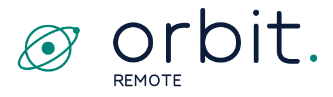
  </picture>
  <h1>Your world. Within reach.</h1>
  <p><strong>A native desktop workspace for reaching your own computers over Tailscale.</strong></p>
  <p>View a screen. Take control with permission. Keep every paired device accountable.</p>
  <p>
    <a href="docs/VALIDATION.md"></a>
    <a href="https://github.com/Optimizer077/orbit-remote-public/releases/tag/v0.1.0-preview.2"></a>
    <a href="docs/ARCHITECTURE.md"></a>
    <a href="docs/ENCRYPTION.md"></a>
    <a href="docs/MACOS.md"></a>
  </p>
  <p>
    <a href="https://github.com/Optimizer077/orbit-remote-public/releases/tag/v0.1.0-preview.2"><strong>Download Windows</strong></a> ·
    <a href="docs/MACOS.md">Continue on a Mac</a> ·
    <a href="docs/ARCHITECTURE.md">How it works</a> ·
    <a href="TODO.md">Roadmap</a> ·
    <a href="CONTRIBUTING.md">Contribute</a>
  </p>
</div>

<p align="center">
  <picture>
    <source media="(max-width: 767px) and (prefers-reduced-motion: reduce)" srcset="docs/assets/orbit-flow-narrow-static.svg">
    <source media="(max-width: 767px)" srcset="docs/assets/orbit-flow-narrow.svg">
    <source media="(prefers-reduced-motion: reduce)" srcset="docs/assets/orbit-flow-static.svg">
    
  </picture>
</p>

> **Public development preview, with explicit limits.** Windows has local runtime evidence. macOS and Linux need native device validation. Downloads are unsigned; unattended access before login and production security are not established.

Orbit Remote connects **your own** Windows, macOS, and Linux computers over your private [Tailscale](https://tailscale.com) network. Every installation is both a viewer and a host. Access comes only from an invitation you create, a certificate pinned at pairing, and the permissions the host's owner grants. Orbit runs no server or account, and it never changes your startup, firewall, or Tailscale policy on its own.

<p align="center">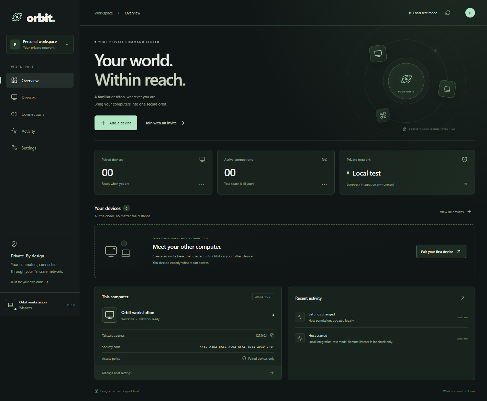</p>

## Contents

[At a glance](#at-a-glance) · [Why Orbit](#why-orbit) · [How it works](#how-it-works) · [Security](#security) · [Get started](#get-started) · [Features](#features) · [Themes](#themes) · [Platform support](#platform-support) · [Project status](#project-status) · [Develop](#develop) · [Documentation](#documentation) · [Contributing](#contributing)

## At a glance

| **Private by design** | **Encrypted twice** | **Trust you can check** |
|---|---|---|
| No Orbit server, account, or relay. Your computers reach each other directly over your own tailnet. | Tailscale WireGuard outside, Orbit mutual TLS 1.3 inside. Both sides refuse weaker encryption. | Single-use invitations, pinned certificates, and a security code you compare once by eye. |
| **Permission, not presumption** | **Honest status** | **One app, three systems** |
| View, control, clipboard, files, and power are separate grants that the host enforces and you can revoke. | The viewer shows the encryption actually negotiated. Unsupported states are labeled, never faked. | Windows is exercised today; macOS and Linux adapters are built and await device validation. |

## Why Orbit

You have a few computers and want to reach them from each other, without handing your screen to a third party or opening a door to the internet. The usual options each give something up:

| Usual approach | What you give up | What Orbit does instead |
|---|---|---|
| Cloud remote-desktop services | An account and a vendor's broker sit between your computers. | No Orbit server or account. Computers connect directly over **your own** Tailscale network. |
| RDP/VNC ports open to the internet or LAN | An exposed login screen anyone on the network can attack. | Listens only on its Tailscale address, and every peer must hold a certificate you paired explicitly. |
| VPN + RDP | Usually one OS, and all-or-nothing desktop access. | One app for Windows, macOS, and Linux, with **separate grants** for view, control, clipboard, files, and power. |
| "Trust us, it's encrypted" | You can't see what protects you. | **Two encryption layers** you can inspect: the negotiated cipher is shown live, and a security code confirms each pairing. |

Orbit is for reaching your own computers, or ones whose owner explicitly invited you. It is not built for unattended fleet management or for access before anyone has signed in.

## How it works

**Your viewer asks; the host decides.** Every request crosses two encryption layers and four checks on the host before it reaches the desktop.

<p align="center">
  <picture>
    <source media="(max-width: 767px) and (prefers-color-scheme: dark)" srcset="docs/assets/diagrams/how-it-works-narrow.svg">
    <source media="(max-width: 767px)" srcset="docs/assets/diagrams/how-it-works-narrow-light.svg">
    <source media="(prefers-color-scheme: dark)" srcset="docs/assets/diagrams/how-it-works.svg">
    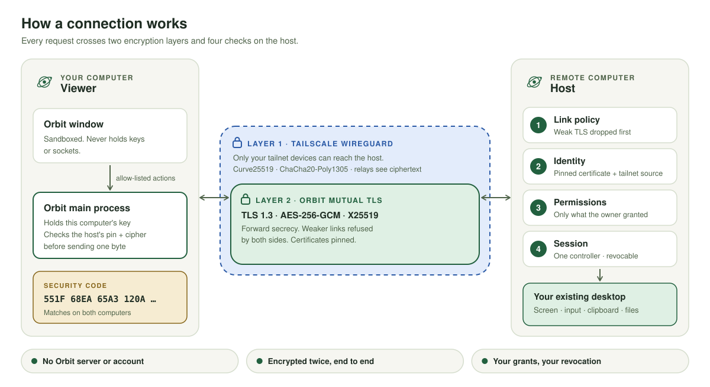
  </picture>
</p>

### What happens when you click Connect

1. **The window asks, the main process acts.** The sandboxed Orbit window can only send allow-listed actions to Orbit's main process. It never sees keys, sockets, or the local control token.
2. **Outbound checks.** The main process accepts only a literal Tailscale IP, offers only strong TLS suites, and presents this computer's certificate.
3. **Nothing goes to an unverified host.** Before a single HTTP byte is sent, the viewer checks the host's certificate against the SHA-256 pin saved at pairing, and checks that the negotiated encryption meets policy.
4. **The host's four gates.** Tailscale delivers only tailnet traffic to port `47832`. The host then ① drops any link below the TLS policy, ② confirms the source with `tailscale whois` and matches the viewer's certificate to an unrevoked pairing, ③ applies that device's grants, and ④ opens a session. One device controls at a time; others can view.
5. **Screen updates.** The host captures the chosen monitor and sends it over the double-encrypted link. The viewer shows it with the measured encryption, for example `TLS 1.3 · AES-256-GCM · X25519`.
6. **Input needs two yeses.** The owner must have granted control, and you must choose **Take control**. Input is bounded and coalesced, and held keys are released if the viewer disappears. **Esc** gives control back.
7. **Ending is final.** Disconnect, **Disconnect all**, or a host stop ends the session with `410`, and the viewer never silently reconnects. Revoking the device (`401`) removes its access.

### What runs on each computer

<p align="center">
  <picture>
    <source media="(max-width: 767px) and (prefers-color-scheme: dark)" srcset="docs/assets/diagrams/processes-narrow.svg">
    <source media="(max-width: 767px)" srcset="docs/assets/diagrams/processes-narrow-light.svg">
    <source media="(prefers-color-scheme: dark)" srcset="docs/assets/diagrams/processes.svg">
    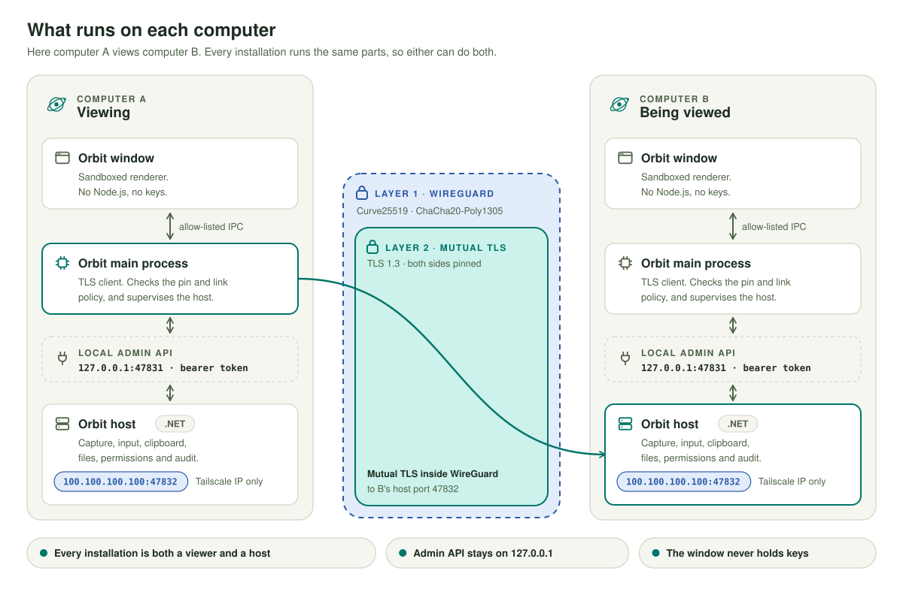
  </picture>
</p>

The Orbit window is sandboxed with no Node.js access. Keys and the local control token stay in the main process and the host. The host has a local admin API on `127.0.0.1:47831` (bearer token) for its own app, and listens remotely only on its verified Tailscale address. There is no public or LAN listener, remote shell, or router port forwarding. Read [the architecture](docs/ARCHITECTURE.md) for trust boundaries and how multiple screen windows share one session.

## Security

### Encrypted in layers

<p align="center">
  <picture>
    <source media="(max-width: 767px) and (prefers-color-scheme: dark)" srcset="docs/assets/diagrams/layers-narrow.svg">
    <source media="(max-width: 767px)" srcset="docs/assets/diagrams/layers-narrow-light.svg">
    <source media="(prefers-color-scheme: dark)" srcset="docs/assets/diagrams/layers.svg">
    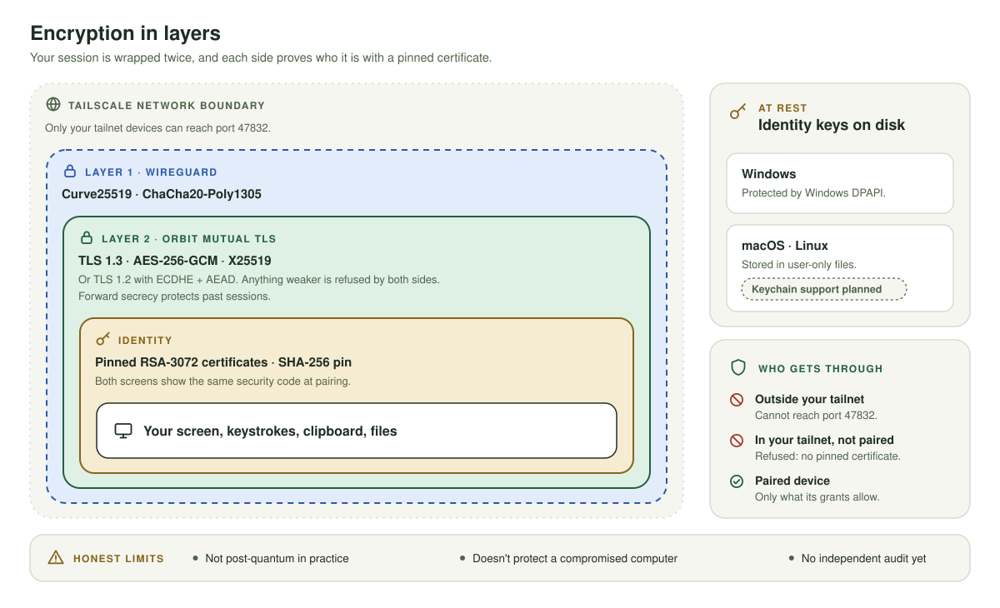
  </picture>
</p>

1. **Network: Tailscale WireGuard.** Only your tailnet devices can reach the host. Traffic between them is encrypted with Curve25519 and ChaCha20-Poly1305, including through Tailscale relays.
2. **Application: Orbit mutual TLS, inside that tunnel.** TLS 1.3, or TLS 1.2 with ECDHE + AES-GCM/ChaCha20-Poly1305 only. Every allowed suite has forward secrecy. The viewer offers only those suites, and the host independently drops anything weaker before reading a request.
3. **Identity: pinned certificates.** Each computer has its own RSA-3072 identity. Pins are checked on every connection, so a changed certificate is blocked as "Device identity changed".
4. **Access: host permissions.** A verified device still gets only what the owner granted.
5. **At rest: protected keys.** Identity keys are encrypted with your Windows account (DPAPI). macOS and Linux use user-only files, with native keychains planned.

Measured against the real Windows host: clients offering only CBC or static-RSA suites were *served* before this policy and are *refused* now. See [How Orbit protects your connection](docs/ENCRYPTION.md).

### Pairing and the security code

<p align="center">
  <picture>
    <source media="(max-width: 767px) and (prefers-color-scheme: dark)" srcset="docs/assets/diagrams/pairing-narrow.svg">
    <source media="(max-width: 767px)" srcset="docs/assets/diagrams/pairing-narrow-light.svg">
    <source media="(prefers-color-scheme: dark)" srcset="docs/assets/diagrams/pairing.svg">
    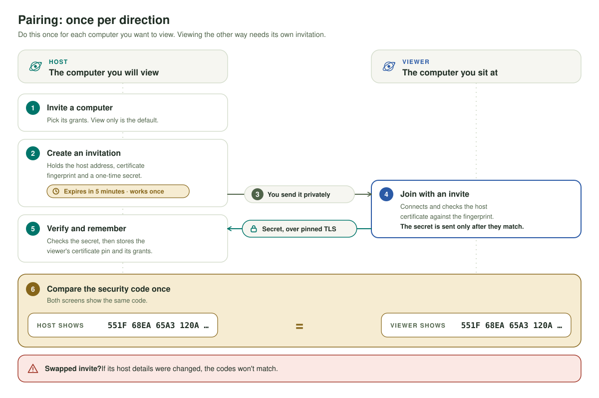
  </picture>
</p>

The invitation is a secret for five minutes and works once. The viewer verifies the host's certificate **before** revealing that secret. Afterwards both computers show the same eight-group **security code**: compare it once. If someone tampered with the invitation's host details, the codes won't match. A leaked invitation still works only once: if a device you don't recognise appears under the host's devices, revoke it.

### What a paired device can do

<p align="center">
  <picture>
    <source media="(max-width: 767px) and (prefers-color-scheme: dark)" srcset="docs/assets/diagrams/permissions-narrow.svg">
    <source media="(max-width: 767px)" srcset="docs/assets/diagrams/permissions-narrow-light.svg">
    <source media="(prefers-color-scheme: dark)" srcset="docs/assets/diagrams/permissions.svg">
    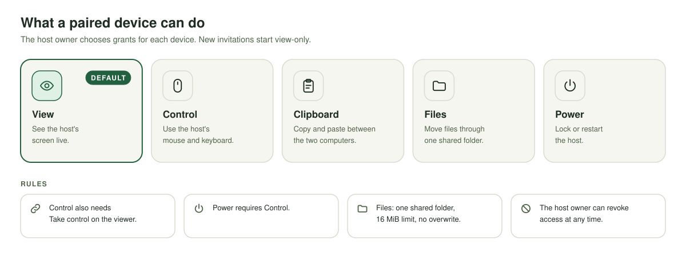
  </picture>
</p>

| Grant | What it allows | Notes |
|---|---|---|
| **View** | See the chosen screen | The default: new invitations are view-only |
| **Control** | Mouse and keyboard | Also needs **Take control** on the viewer; **Esc** releases it |
| **Clipboard** | Read and write text | Explicit actions only, never automatic sync |
| **Files** | Upload and download | One shared folder, no overwrite, 16 MiB per transfer |
| **Power** | Lock or restart | Requires Control, and the host's own policy must allow it |

The host enforces every grant on every request, and the owner can revoke a device at any time.

### Session lifecycle

<p align="center">
  <picture>
    <source media="(max-width: 767px) and (prefers-color-scheme: dark)" srcset="docs/assets/diagrams/lifecycle-narrow.svg">
    <source media="(max-width: 767px)" srcset="docs/assets/diagrams/lifecycle-narrow-light.svg">
    <source media="(prefers-color-scheme: dark)" srcset="docs/assets/diagrams/lifecycle.svg">
    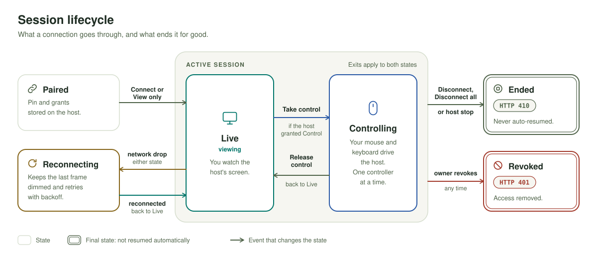
  </picture>
</p>

- **Paired → Live:** choose **Connect** or **View only**.
- **Live ↔ Controlling:** **Take control** (if granted); **Esc** gives it back.
- **Reconnecting:** after a network drop, the session renews with the same identity, and permissions are rechecked.
- **Ended (`410`):** Disconnect, **Disconnect all**, or a host stop. Never resumed automatically, even after a restart.
- **Revoked (`401`):** the owner removed the device; it must be invited again.

### Limits, stated plainly

- It does not protect a compromised computer: malware or an administrator on either end can see what you see.
- It is not post-quantum in practice: the Windows host negotiates classical X25519.
- It has had no independent security audit yet, and the builds are unsigned previews.

Read [SECURITY.md](SECURITY.md) before deployment. Report security concerns privately to the repository owner.

## Get started

### Download for Windows

Get the [preview release](https://github.com/Optimizer077/orbit-remote-public/releases/tag/v0.1.0-preview.2):

| Download | Use it when |
|---|---|
| `Orbit-Remote-Setup-0.1.0-x64.exe` | You want Orbit installed for your Windows user, with a Start menu shortcut. |
| `Orbit-Remote-Portable-0.1.0-x64.exe` | You want to run one EXE without installing. |
| `SHA256SUMS.txt` | You want to check the download's SHA-256 checksum. |

<details>
<summary>Install notes</summary>

Both EXEs bundle the host and the .NET runtime. You need Tailscale installed and connected, but not Node.js or the .NET SDK. The installer doesn't enable startup, change firewall or Tailscale policy, or launch Orbit when it finishes. The portable app saves settings and its identity in the normal per-user application-data folder. Startup at sign-in is available only in the installed build. Uninstalling keeps your local profile, so pairing keys are never silently deleted.

</details>

These are **unsigned preview builds**, without independent security review or full device validation.

### Connect two computers

1. Run Orbit and Tailscale on both computers. Limit your tailnet policy to the intended devices and TCP port **47832**.
2. On the computer to control, choose **Add a device**, pick permissions, and create an invitation. New invitations are view-only until you enable more.
3. Send the invitation directly to the other computer. It's private, expires in five minutes, and works once.
4. On the viewer, choose **Join with an invite** and paste it.
5. **Compare security codes once:** **Overview → This computer** on the host, and the new device's **⋯** menu on the viewer. They must match exactly.
6. Choose **Connect** or **View only**, then **Take control** if you were granted it. **Esc** releases control.
7. To connect in the other direction, create an invitation on the other computer.

Revoke an incoming device or forget an outgoing one at any time. The tray menu offers **Disconnect all incoming sessions** and **Quit Orbit and stop remote access**.

### Build on macOS or Linux

Install Git, Node.js 24 LTS, the .NET 10 SDK matching `global.json`, and Tailscale. Then:

```bash
git clone https://github.com/Optimizer077/orbit-remote-public.git
cd orbit-remote-public
bash scripts/start-dev.sh          # development run
bash scripts/build.sh --package    # native package (DMG on macOS)
```

The script detects Apple silicon or Intel and builds a matching host and package. Read [the Mac handoff](docs/MACOS.md) for privacy permissions and first cross-device tests. Compilation alone does not validate Mac support.

## Features

| Area | What you get today |
|---|---|
| Workspace | Overview, Devices, Connections, Activity, and Settings, all showing real host data. |
| Trust | Five-minute single-use invitations, pinned certificates, mutual TLS identities, and comparable security codes. |
| Encryption | WireGuard + mutual TLS 1.3 (or 1.2 ECDHE + AEAD). Weaker links are refused, and the negotiated encryption is shown live. |
| Permissions | Separate view, control, clipboard, files, and power grants, enforced on the host. |
| Viewing | Real monitors, display selection, fit and 1:1 modes, and separate windows for existing host displays. |
| Input | Native keyboard and mouse, explicit **Take control**, bounded queues, and automatic release of held keys. |
| Sharing | Many viewers, one controller, revocation, and **Disconnect all**. A host-ended session is never auto-resumed. |
| Clipboard & files | Explicit text clipboard; one chosen transfer folder, no overwrite, 16 MiB per transfer. |
| Power | Optional lock and restart, gated by host policy and the device's grant. |
| Reliability | Host supervision, owner-exit shutdown, and renewal that rechecks identity and permissions. |

Screen delivery currently polls compressed PNG frames. Weak-network support (skipping unchanged frames, adaptive quality, reconnect handling) is planned. There is no verified FPS benchmark yet, and audio is not implemented.

## Themes

Choose a theme in **Settings**, or let Orbit follow your system's light or dark mode.

| Orbit | Midnight | Paper |
|:---:|:---:|:---:|
| <a href="docs/assets/overview.png"></a> | <a href="docs/assets/midnight.png">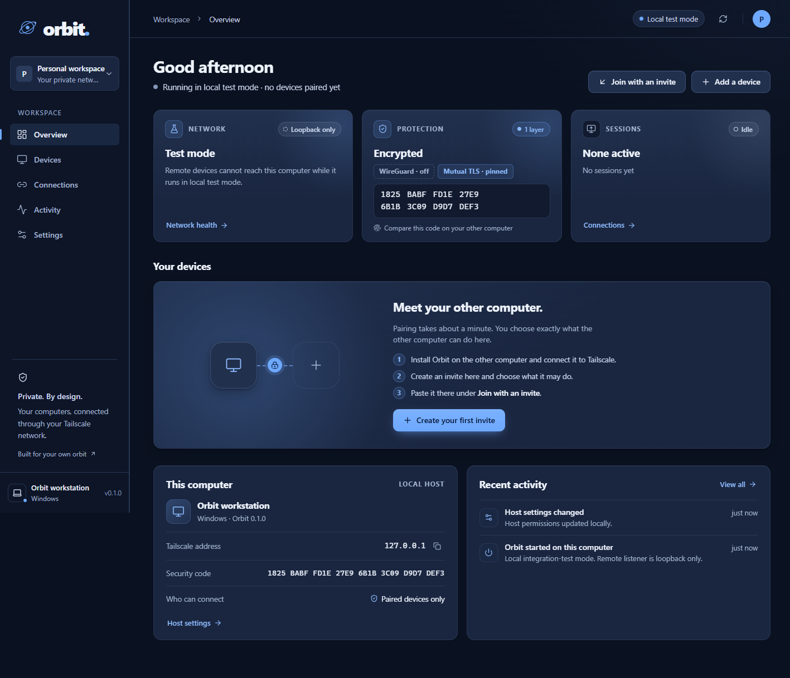</a> | <a href="docs/assets/paper.png">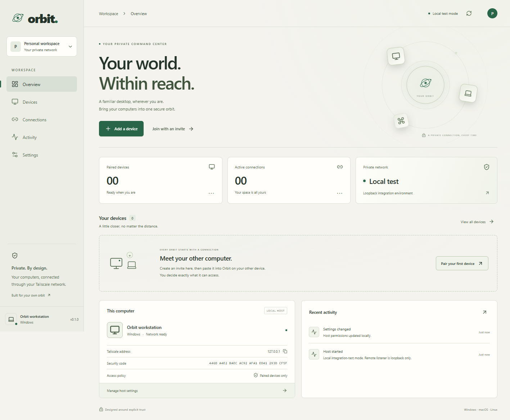</a> |

The [brand guide](docs/BRAND.md) covers the logo, icons, palette, type, and motion.

## Platform support

| Capability | Windows | macOS | Linux |
|---|---|---|---|
| Desktop GUI | Exercised locally | Needs native build/test | Needs native build/test |
| Unlocked capture | Native GDI, exercised | Native helper, permission required | X11 + ffmpeg |
| Input | SendInput adapter | CoreGraphics + Accessibility | X11 + xdotool |
| Text clipboard | Win32 | pbcopy/pbpaste | X11 + xclip |
| Locked/sign-in/UAC screen | **Unsupported** | **Unsupported** | **Unsupported** |
| Startup at user sign-in | Installed build option | Packaged option, needs validation | Deployment work remains |
| Boot before user login | **Not implemented** | **Not implemented** | **Not implemented** |
| Wayland | N/A | N/A | **Unsupported; fails closed** |

## Project status

| Status | What that means today |
|---|---|
| **Exercised locally** | Windows capture, certificate-authenticated loopback sessions, pairing and revocation, link policy, themes, and packaged-app recovery. See the [validation record](docs/VALIDATION.md). |
| **Built; needs device validation** | macOS and Linux adapters and build scripts; physical cross-device sessions; native input and privacy permissions. |
| **Planned / unsupported** | Locked and sign-in screens, access before login, Wayland, virtual monitors, hardware video, audio, and signed updates. See [next steps](TODO.md). |

## Develop

```powershell
# Windows
.\scripts\start-dev.ps1
.\scripts\check.ps1
.\scripts\build.ps1 -Runtime win-x64 -Package
```

```bash
# macOS / Linux
bash scripts/start-dev.sh
dotnet run --project tests/Orbit.Host.Tests/Orbit.Host.Tests.csproj
cd apps/desktop && npm test && npm run build
```

For local-only testing, use `start-dev.ps1 -LoopbackTest` or `start-dev.sh --loopback-test`. This binds remote TLS to loopback and labels the UI **Local test mode**.

<details>
<summary>Repository map</summary>

```text
apps/desktop/renderer/            Interface, themes, About, and motion
apps/desktop/electron/            Bridge, TLS client, sessions, supervision
apps/desktop/build/icons/         App and tray icons (optical small sizes)
apps/desktop/electron-builder.cjs Installer and host-bundle checks
src/Orbit.Host/                   Host, trust, permissions, files, audit
src/Orbit.Host/Platform/          Native OS adapters
tests/Orbit.Host.Tests/           Real TLS and native-boundary checks
scripts/                          Windows and Unix launch/build workflows
docs/                             Architecture, encryption, protocol, validation, brand
```

Packaging checks each executable's real OS and architecture; build native packages on their target OS. Linux needs a signed-in X11 desktop, logind, ffmpeg with x11grab, xdotool, xrandr, and xclip. `docs/ci-example.yml` is a CI template, not active CI.

</details>

## Documentation

| Use Orbit | Understand the system | Help build it |
|---|---|---|
| [Mac development handoff](docs/MACOS.md) | [Architecture and trust boundaries](docs/ARCHITECTURE.md) | [Prioritized checklist](TODO.md) |
| [Security model](SECURITY.md) | [How your connection is encrypted](docs/ENCRYPTION.md) | [Contribution guide](CONTRIBUTING.md) |
| [Validation record](docs/VALIDATION.md) | [Pairing and API protocol](docs/PROTOCOL.md) | [Release plan](docs/PLAN.md) |
| [Changelog](CHANGELOG.md) | [Performance and measurement](docs/PERFORMANCE.md) | [Brand guide](docs/BRAND.md) |
| | [Extra screens and virtual displays](docs/VIRTUAL_DISPLAYS.md) | |

## Contributing

Start with a small item from [TODO.md](TODO.md) and follow [CONTRIBUTING.md](CONTRIBUTING.md). Mac device testing, permission recovery, and reproducible performance measurements are especially welcome. Record the OS and hardware you actually exercised: compilation or a mock does not establish native support.

Each computer generates its own identity. **Never copy keys or application-data folders between computers, or commit them.**


No software license is declared yet; license selection is tracked in the checklist. This preview is not a production security certification.
