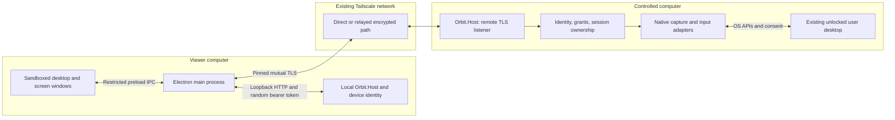
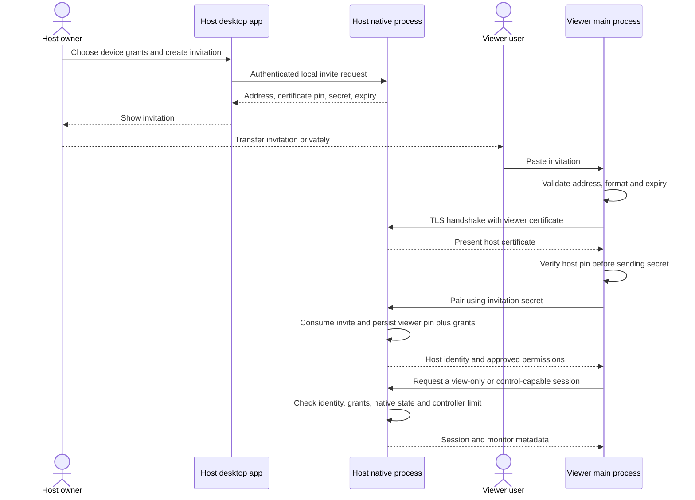
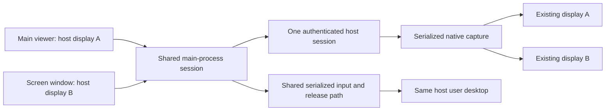

# Orbit Remote architecture

  <picture>
    <source media="(max-width: 767px) and (prefers-color-scheme: dark)" srcset="assets/diagrams/architecture-narrow.svg">
    <source media="(max-width: 767px)" srcset="assets/diagrams/architecture-narrow-light.svg">
    <source media="(prefers-color-scheme: dark)" srcset="assets/diagrams/architecture.svg">
    
  </picture>

Orbit connects a viewer to an explicitly paired host over an existing Tailscale network. Every installation can perform both roles. The current application shares an existing, signed-in, unlocked desktop; it does not create a separate login session or provide access to preboot screens.

This document describes the preview implementation and the boundaries that future work must preserve. Windows has local runtime evidence. macOS and Linux backends need native device validation; see [VALIDATION.md](VALIDATION.md). Read the [protocol](PROTOCOL.md) for exact routes and limits and [SECURITY.md](../SECURITY.md) for the threat model.

## Processes and data flow

The main process owns outgoing connections, session state, native dialogs, and the child-host lifetime. Its renderer bridge exposes named operations rather than arbitrary URLs, filesystem access, shell commands, or raw keys. The renderer has no Node.js access and does not receive the local control token or private keys.

The local host owns its device identity, incoming authorizations, native adapters, and receiving sessions. Local administration binds to `127.0.0.1:47831` by default and requires a fresh bearer token. The production remote listener binds to a verified Tailscale IPv4 address on TCP `47832`; discovery failure leaves remote listening disabled. The explicit test mode uses loopback instead. There is no wildcard, LAN, or public listener fallback.

The desktop supervises the child host and keeps a private stdin ownership pipe open. If the desktop exits, EOF asks the host to stop and release held input. This is a user-session application, not an installed privileged system service. Closing a window keeps the app in its tray/menu bar; **Quit Orbit and stop remote access** ends it.

Tailscale provides network reachability and encrypted tunnels. Direct and relayed paths are possible; Orbit does not operate its own rendezvous or relay service. The path may change while devices communicate. [Tailscale connection types](https://tailscale.com/docs/reference/connection-types)

## Trust boundaries

| Boundary | Enforcement in the preview | Remaining work |
|---|---|---|
| Renderer to main | Sandboxed renderer, context isolation, constrained preload API, frame/sender checks, and request-size limits. Screen windows are attached to an existing session. | Continue denial tests as new windows and bridge operations are added. |
| Main to local host | Loopback-only administration, random bearer token, browser-origin rejection, and no renderer access to the token. | Consider keeping outgoing TLS entirely in the host to reduce main-process key exposure. |
| Network to host | Tailscale-address binding and source verification, TLS client certificates, certificate pins, and explicit application pairing. | Native testing across Tailscale reconnects, source changes, and device revocation. |
| Paired device to capability | Host checks the presented identity, current authorization, session ownership, and each feature grant. View-only sessions remove non-view grants. | New channels need separate host-enforced permissions and resource budgets. |
| Host to OS desktop | Fixed native adapters, desktop-state guards, and OS permissions; no general remote shell or automatic privilege escalation. | Signed helpers, service/session brokers, Wayland, and unattended lifecycle support. |
| Persistent identity to local storage | Windows current-user DPAPI; user-only directory/file modes on macOS and Linux. | Keychain/libsecret integration, rotation, recovery, and migrations. |

An authorized controller can exercise the desktop permissions its owner granted. A same-user local process or administrator is outside the current isolation boundary. The preview has not received independent security certification.

## Pairing and opening a session

Invitations expire after five minutes, can be consumed once, and are bearer credentials until then. The host holds only a secret hash in memory; unused invitations disappear at host restart. The viewer verifies the host certificate before transmitting the secret. Successful pairing associates the viewer's actual TLS certificate with the chosen grants. Certificate possession and network reachability alone do not authorize normal application routes.

Pairing is directional. A Mac controlling a Windows PC needs an authorization on the PC. For the PC to control the Mac, create a separate invitation on the Mac. Forgetting an outgoing connection removes local metadata; revoking an incoming authorization removes access on that host and ends its sessions.

Session renewal reuses the paired identity and rechecks current permissions. It cannot restore a revoked authorization. There is one controlling session per host; view-only sessions can coexist. Mouse/keyboard input also requires the viewer's explicit **Take control** action, and held input is released on focus loss, Escape, disconnect, or lease expiry.

## Multiple windows and existing remote monitors

An active connection can open an existing host display in a separate local window. The main window and screen windows refer to the **same authenticated remote session**. Per-frame monitor selection changes which existing display is captured; it does not allocate a second controller or replace the session to switch monitors.

Each window keeps its monitor context so input uses the dimensions and physical origin of the frame it displays. The native host validates coordinates against reported displays. This does not establish per-display security isolation: a controlling session operates the same user's desktop. Closing a screen window releases input while leaving other windows connected. Ending the parent session ends its attached screen windows.

**Opening another viewer window does not create another monitor.** A virtual display would add a new OS output on the host, with applications able to move onto it. That requires an OS-specific provider, permission design, ownership/cleanup, and native validation. No virtual display driver, kernel extension, or OS display-creation provider is installed by this preview. See [VIRTUAL_DISPLAYS.md](VIRTUAL_DISPLAYS.md) for the separate engineering plan.

## Platform adapters and next changes

| Platform | Current adapter | Boundary |
|---|---|---|
| Windows | GDI capture, SendInput, Win32 clipboard, monitor enumeration. | Existing unlocked interactive desktop; secure desktop, sign-in, and Session 0 are unsupported. |
| macOS | CoreGraphics monitor/input APIs, screenshot helper, clipboard helpers, permission preflight. | Requires local Screen Recording and Accessibility approval; runtime unvalidated. |
| Linux | X11 capture/input/clipboard helpers and dependency checks. | Existing accessible X11 session; runtime unvalidated. Wayland fails closed. |

The [release plan](PLAN.md) separates native validation, unattended lifecycle, video transport, and secure distribution. [PERFORMANCE.md](PERFORMANCE.md) explains the current PNG pipeline and how to measure improvements. [TODO.md](../TODO.md) is the actionable handoff checklist, starting with Mac-to-Windows and Windows-to-Mac testing.
