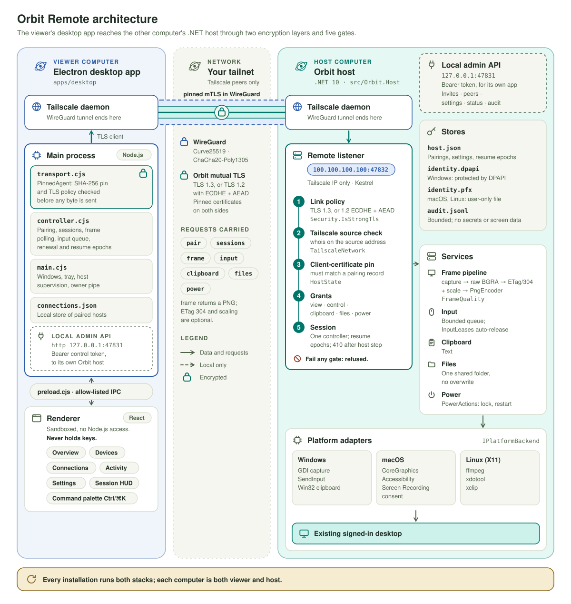

# Orbit Remote architecture

  <picture>
    <source media="(max-width: 767px) and (prefers-color-scheme: dark)" srcset="assets/diagrams/architecture-narrow.svg">
    <source media="(max-width: 767px)" srcset="assets/diagrams/architecture-narrow-light.svg">
    <source media="(prefers-color-scheme: dark)" srcset="assets/diagrams/architecture.svg">
    
  </picture>

Orbit connects a viewer to an explicitly paired host over an existing Tailscale network. Every installation can perform both roles. The current application shares an existing, signed-in, unlocked desktop; it does not create a separate login session or provide access to preboot screens.

This document describes the preview implementation and the boundaries that future work must preserve. Windows has local runtime evidence. macOS and Linux backends need native device validation; see [VALIDATION.md](VALIDATION.md). Read the [protocol](PROTOCOL.md) for exact routes and limits and [SECURITY.md](../SECURITY.md) for the threat model.

## Processes and data flow

  <picture>
    <source media="(max-width: 767px) and (prefers-color-scheme: dark)" srcset="assets/diagrams/architecture-narrow.svg">
    <source media="(max-width: 767px)" srcset="assets/diagrams/architecture-narrow-light.svg">
    <source media="(prefers-color-scheme: dark)" srcset="assets/diagrams/architecture.svg">
    
  </picture>

- **Viewer computer:** sandboxed desktop and screen windows talk to the Electron main process only through restricted preload IPC; the main process talks to its own local Orbit.Host (device identity) over loopback HTTP with a random bearer token.
- **Network:** your existing Tailscale network carries a direct or relayed encrypted path.
- **Controlled computer:** Orbit.Host's remote TLS listener checks identity, grants and session ownership, then drives native capture and input adapters on the existing unlocked user desktop (OS APIs and consent).
- The viewer main process reaches the remote listener with **pinned mutual TLS** inside that tunnel.

The main process owns outgoing connections, session state, native dialogs, and the child-host lifetime. Its renderer bridge exposes named operations rather than arbitrary URLs, filesystem access, shell commands, or raw keys. The renderer has no Node.js access and does not receive the local control token or private keys.

The local host owns its device identity, incoming authorizations, native adapters, and receiving sessions. Local administration binds to `127.0.0.1:47831` by default and requires a fresh bearer token. The production remote listener binds to a verified Tailscale IPv4 address on TCP `47832`; discovery failure leaves remote listening disabled. The explicit test mode uses loopback instead. There is no wildcard, LAN, or public listener fallback.

The desktop supervises the child host and keeps a private stdin ownership pipe open. If the desktop exits, EOF asks the host to stop and release held input. This is a user-session application, not an installed privileged system service. Closing a window keeps the app in its tray/menu bar; **Quit Orbit and stop remote access** ends it.

Tailscale provides network reachability and encrypted tunnels. Direct and relayed paths are possible; Orbit does not operate its own rendezvous or relay service. The path may change while devices communicate. [Tailscale connection types](https://tailscale.com/docs/reference/connection-types)

## Trust boundaries

| Boundary | Enforcement in the preview | Remaining work |
|---|---|---|
| Renderer to main | Sandboxed renderer, context isolation, constrained preload API, frame/sender checks, and request-size limits. Screen windows are attached to an existing session. | Continue denial tests as new windows and bridge operations are added. |
| Main to local host | Loopback-only administration, random bearer token, browser-origin rejection, and no renderer access to the token. | Consider keeping outgoing TLS entirely in the host to reduce main-process key exposure. |
| Network to host | Tailscale-address binding and source verification, TLS client certificates, certificate pins, and explicit application pairing. | Native testing across Tailscale reconnects, source changes, and device revocation. |
| Paired device to capability | Host checks the presented identity, current authorization, session ownership, and each feature grant. View-only sessions remove non-view grants. | New channels need separate host-enforced permissions and resource budgets. |
| Host to OS desktop | Fixed native adapters, desktop-state guards, and OS permissions; no general remote shell or automatic privilege escalation. | Signed helpers, service/session brokers, Wayland, and unattended lifecycle support. |
| Persistent identity to local storage | Windows current-user DPAPI; user-only directory/file modes on macOS and Linux. | Keychain/libsecret integration, rotation, recovery, and migrations. |

An authorized controller can exercise the desktop permissions its owner granted. A same-user local process or administrator is outside the current isolation boundary. The preview has not received independent security certification.

## Pairing and opening a session

  <picture>
    <source media="(max-width: 767px) and (prefers-color-scheme: dark)" srcset="assets/diagrams/pairing-narrow.svg">
    <source media="(max-width: 767px)" srcset="assets/diagrams/pairing-narrow-light.svg">
    <source media="(prefers-color-scheme: dark)" srcset="assets/diagrams/pairing.svg">
    
  </picture>

1. The host owner chooses device grants and creates an invitation in the host desktop app; the app asks the host process over the authenticated local API.
2. The host returns the address, certificate pin, secret and expiry, and the app shows the invitation.
3. The owner transfers the invitation privately; the viewer user pastes it.
4. The viewer main process validates the address, format and expiry, then opens TLS with its own viewer certificate.
5. The host presents its certificate; the viewer **verifies the host pin before sending the secret**.
6. The viewer pairs with the invitation secret; the host consumes the invite and persists the viewer pin plus grants, then returns its identity and the approved permissions.
7. The viewer requests a view-only or control-capable session; the host checks identity, grants, native state and the controller limit, and returns session and monitor metadata.

Invitations expire after five minutes, can be consumed once, and are bearer credentials until then. The host holds only a secret hash in memory; unused invitations disappear at host restart. The viewer verifies the host certificate before transmitting the secret. Successful pairing associates the viewer's actual TLS certificate with the chosen grants. Certificate possession and network reachability alone do not authorize normal application routes.

Pairing is directional. A Mac controlling a Windows PC needs an authorization on the PC. For the PC to control the Mac, create a separate invitation on the Mac. Forgetting an outgoing connection removes local metadata; revoking an incoming authorization removes access on that host and ends its sessions.

Session renewal reuses the paired identity and rechecks current permissions. It cannot restore a revoked authorization. There is one controlling session per host; view-only sessions can coexist. Mouse/keyboard input also requires the viewer's explicit **Take control** action, and held input is released on focus loss, Escape, disconnect, or lease expiry.

## Screen streaming

A session shows the remote screen as hardware video when the host supports it, and as single images otherwise. Both paths use the same session, grants, and pinned mutual-TLS connection pool.

1. **Capture (host).** On Windows, one shared producer per monitor duplicates the screen on that monitor's GPU (DXGI Desktop Duplication). It serves both the video stream and image requests.
2. **Encode (host).** The GPU's H.264 encoder, through Windows Media Foundation, runs in low-latency mode with no B-frames. A keyframe is sent when a viewer joins or asks for one.
3. **Stream records (network).** The viewer's main process opens one long `GET /api/sessions/{id}/stream` response. Its body is a sequence of records with a fixed 24-byte header: configuration, video, heartbeat, cursor, and a terminal record that states why the stream ended. Acknowledgements, keyframe requests, and quality changes go back in small separate `POST` requests. The host limits unacknowledged frames and skips capture while the link is behind, instead of queueing old frames. It rechecks the session, revocation, and the viewing grant at least once per second and ends the stream within 1 s of losing authority.
4. **Decode (viewer).** The main process validates every record header and passes video to a decoder worker in the screen window, at most three records ahead of what the worker has handled. The worker decodes every frame with WebCodecs, asking for a hardware decoder first and using the software decoder if hardware is unavailable or fails before its first frame. If 12 frames are already waiting to be decoded, or the oldest has waited more than 500 ms, the decoder is reset, the last picture stays on screen, and a keyframe is requested.
5. **Present (viewer).** At most two frames are drawn per display refresh: one at once, when it is the newest frame there is, and the newest waiting frame at the refresh itself. A decoded frame replaced before it could be shown is released at once and counted as replaced, not dropped. The viewer draws the pointer itself from cursor records that the host sends separately from the video.

**Image fallback.** When the host does not offer video (Mac and Linux hosts today), answers that it cannot stream, or the stream fails, the viewer requests single images and retries video automatically. Windows hosts send PNG or JPEG, whichever is smaller; Mac and Linux hosts send PNG. A display that is asleep produces a typed `display_asleep` result instead of a frozen picture. See the [protocol](PROTOCOL.md) for the exact records and limits and [PERFORMANCE.md](PERFORMANCE.md) for measurements.

## Multiple windows and existing remote monitors

An active connection can open an existing host display in a separate local window. The main window and screen windows refer to the **same authenticated remote session**. Per-frame monitor selection changes which existing display is captured; it does not allocate a second controller or replace the session to switch monitors.

1. The main viewer (host display A) and any extra screen window (host display B) share one main-process session.
2. That session is one authenticated host session.
3. Capture is serialized natively per existing display (A, B).
4. Input from every window goes through one shared, serialized input and release path to the same host user desktop.

Each window keeps its monitor context so input uses the dimensions and physical origin of the frame it displays. The native host validates coordinates against reported displays. This does not establish per-display security isolation: a controlling session operates the same user's desktop. Closing a screen window releases input while leaving other windows connected. Ending the parent session ends its attached screen windows.

**Opening another viewer window does not create another monitor.** A virtual display would add a new OS output on the host, with applications able to move onto it. That requires an OS-specific provider, permission design, ownership/cleanup, and native validation. No virtual display driver, kernel extension, or OS display-creation provider is installed by this preview. See [VIRTUAL_DISPLAYS.md](VIRTUAL_DISPLAYS.md) for the separate engineering plan.

## Platform adapters and next changes

| Platform | Current adapter | Boundary |
|---|---|---|
| Windows | GPU capture (DXGI Desktop Duplication, GDI fallback for images), hardware H.264 through Media Foundation, SendInput, Win32 clipboard, monitor enumeration. | Existing unlocked interactive desktop; secure desktop, sign-in, and Session 0 are unsupported. |
| macOS | CoreGraphics monitor/input APIs, screenshot helper (images only, no video), clipboard helpers, permission preflight. | Requires local Screen Recording and Accessibility approval; exercised on Apple silicon ([Mac record](MACOS-VALIDATION.md)), Intel untested. |
| Linux | X11 capture (images only, no video), input and clipboard helpers, and dependency checks. | Existing accessible X11 session; runtime unvalidated. Wayland fails closed. |

The [release plan](PLAN.md) separates native validation, unattended lifecycle, video transport, and secure distribution. [PERFORMANCE.md](PERFORMANCE.md) records the streaming measurements and what is not measured yet. [TODO.md](../TODO.md) is the actionable handoff checklist, starting with Mac-to-Windows and Windows-to-Mac testing.
