# Orbit Remote identity

Orbit is a calm place to reach your own computers. The voice is direct, warm,
and precise about what is connected, who has access, and what a command does.
The line **Your world. Within reach.** describes the product; **Private. By
design.** describes its intent, not a security certification.

## Logo and application icon



The original orbital mark combines a circle, a tilted ellipse, a central device,
and a connected satellite. The lowercase `orbit.` wordmark is original vector
geometry; the dot and satellite share the theme accent. No stock icon, font
outline, or third-party logo is embedded.

- [Default wordmark, for dark surfaces](assets/brand/logo.svg)
- [Light-surface wordmark](assets/brand/logo-light.svg)
- [Midnight wordmark](assets/brand/logo-midnight.svg)
- [Standalone mint mark](assets/brand/mark.svg)
- [Canonical app icon](../apps/desktop/build/icons/icon.svg)
- [Native icon size preview](assets/brand/icon-preview.png)
- [Complete identity sheet](assets/brand/brand-sheet.png)

Keep the original proportions and at least one central-dot diameter of clear
space around the mark. Use the complete wordmark at 165px wide or larger; use
the standalone mark at smaller sizes. The native app icon has its own rounded
surface and transparent corner margins. Do not put a second rounded container
behind it. Do not put glow, gradients, or motion into status-bearing glyphs.

Windows `.ico` includes 16, 24, 32, 48, 64, 128, and 256px representations.
macOS `.icns` includes Retina representations up to 1024px. The shared app PNG
is 1024px with alpha.

**Optical sizes.** At 48px and below, icons are drawn for their pixel grid
instead of being shrunk from the 1024px master, which would turn the stroke
into a 0.4px smear at 16px. Strokes are set in target pixels (1.3px at 16,
2.1px at 48), the mark grows slightly, and a faint mint edge keeps the tile
visible on dark taskbars up to 32px. At 24px the satellite is dropped. At
16px only the orbit and centre node remain.

Tray images follow Electron's 16px-at-1x convention. Windows/Linux use the
small tiled icon (`tray.png` 16px, `@1.5x` 24px, `@2x` 32px), which stays
visible on both light and dark taskbars; a bare mint glyph disappears on a
light taskbar. macOS uses black template glyphs (`trayTemplate.png` 16px,
`@2x` 32px) that the native application marks as templates so the menu bar
chooses the contrast.

## Palette and type

| Role | Orbit | Midnight | Paper |
|---|---|---|---|
| Background | `#101616` | `#101521` | `#f4f3ee` |
| Surface | `#18231d` | `#172337` | `#fffefa` |
| Primary text | `#eceee7` | `#eef2fb` | `#243329` |
| Accent | `#b2e6c5` | `#aecaff` | `#286647` |
| Accent ink | `#1c3524` | `#192c52` | `#ffffff` |

These are the renderer's existing theme tokens. Additional foreground, border,
danger, warning, and viewer colors live in `renderer/src/styles.css`; preserve
their semantic roles when extending themes. Accent does not imply a successful
connection: status must have a text label and use the real connection state.

Use the operating system's UI typeface: Segoe UI Variable / Segoe UI on Windows,
the system font on macOS, and the desktop sans-serif fallback on Linux.
Addresses, diagnostic identifiers, and protocol snippets use the system
monospace stack. Avoid downloadable fonts in the privileged desktop app.

## Motion

Motion should explain a change or make waiting understandable. Hover and focus
responses should finish in roughly 120–180ms; opening panels should finish in
180–260ms. Slow orbital decoration may move only outside the remote desktop
surface. Avoid bouncing controls, flashing indicators, and layout shifts.

Respect `prefers-reduced-motion: reduce`: remove decorative orbiting, pulsing,
and entrance transforms. Loading and connection states must remain readable as
static text; animation must never be the only indication of a connection or
failure. Stop decorative work in hidden views. Never animate captured remote
pixels or obscure control-release actions.

## Rebuild assets

```sh
python -m pip install Pillow
python docs/assets/brand/generate_brand.py
```

The generator draws matching SVG, PNG, ICO, and ICNS files from original
geometry. SVG stays editable as source. Review `icon-preview.png` after any
change, especially at 16px and 32px, and review template contrast in the real
macOS menu bar.
