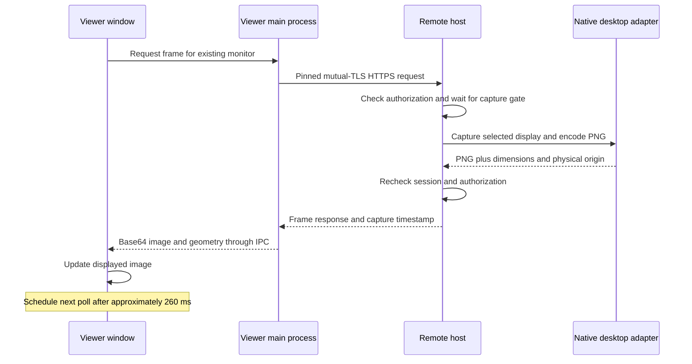

# Orbit Remote performance and streaming plan

The preview uses full PNG screenshots requested over HTTPS. It supports functional desktop viewing and input, but has no verified frame-rate, end-to-end latency, bandwidth, or long-duration resource benchmark. Windows capture has been exercised locally. macOS and Linux performance remains unvalidated.

Use this document to understand current costs and collect evidence before choosing optimizations. The [architecture](ARCHITECTURE.md) describes process and trust boundaries; [VALIDATION.md](VALIDATION.md) records completed checks.

## Current frame pipeline



The renderer schedules the next poll with `setTimeout(..., 260)` after the frame request finishes. **260 ms is the configured waiting period, not measured latency or a delivered frame interval.** Request setup, network round trips, host queueing, capture, PNG encoding, response transfer, and local processing add to the time between requests. Browser scheduling and image decoding can add further visible delay.

A useful model for one window is:

```text
next request begins after approximately:
260 ms + previous request setup + network + host queue/capture/encode
       + response transfer + IPC processing

visible update also depends on image decode and presentation scheduling
```

No term here is a measured benchmark. The timeout is a scheduling request rather than a deadline or guarantee. Reducing it alone cannot remove capture, transfer, or decode cost.

## Costs visible in the implementation

| Stage | Current behavior | Implication to measure |
|---|---|---|
| Capture | Full selected-display screenshots, serialized by the host capture gate. | Larger/Retina displays and more viewer windows can increase work and queueing. |
| Compression | PNG encoding; no negotiated video codec, dirty rectangles, or hardware video encoder. | Compression cost and frame size vary with screen content. Scrolling/video can be expensive. |
| Requests | The TLS transport creates a pinned agent per request and destroys it afterward; keepalive is disabled. | Repeated TCP/TLS setup adds work and network trips. A shared authenticated session does not mean one persistent socket. |
| Delivery | PNG bytes become a base64 data URL sent through Electron IPC. | Encoding, extra allocations, IPC, image decode, and garbage collection need profiling. |
| Multiple displays | Viewer windows share one session. Simultaneous requests for the same monitor share an in-flight request; different monitors have independent frame slots. Host capture remains serialized. | More monitors add capture/encode/transfer work. There is no global adaptive capture/bandwidth scheduler. |
| Input | Input has a separate host gate, bounded viewer queues, and coalesced pointer moves. | Capture is not intentionally ahead of input in the same queue, but CPU/network saturation can still affect responsiveness. |

The native sources are [WindowsPlatformBackend.cs](../src/Orbit.Host/Platform/WindowsPlatformBackend.cs), [MacPlatformBackend.cs](../src/Orbit.Host/Platform/MacPlatformBackend.cs), and [LinuxPlatformBackend.cs](../src/Orbit.Host/Platform/LinuxPlatformBackend.cs). Polling lives in [App.tsx](../apps/desktop/renderer/src/App.tsx); transport setup is in [transport.cjs](../apps/desktop/electron/transport.cjs). These are implementation facts, not evidence of native performance parity.

## Tailscale path matters

A direct Tailscale path generally offers lower latency and more throughput than DERP relay traffic. Peer relay is another possible path. A connection may change paths, so record the actual path during each run rather than assuming that a successful pairing means a direct connection. [Tailscale connection types](https://tailscale.com/docs/reference/connection-types)

While the devices communicate, inspect:

```bash
tailscale status
tailscale ping <peer-tailscale-ip>
```

Record `direct`, DERP `relay`, or `peer-relay` as reported, together with network location and round-trip observations. Keep raw diagnostic output private if it identifies devices or users. Tailscale's status/ping commands help distinguish transport limitations from application work; they do not measure Orbit's capture-to-screen latency. [Tailscale path diagnostics](https://tailscale.com/docs/reference/connection-types#determine-your-connection-type)

## Repeatable measurement checklist

First establish a Windows-to-Mac or Mac-to-Windows session on real hardware. Use a local recovery route, view-only first, and explicit input approval. Do not include lock, restart, clipboard writes, or file transfers in a passive capture benchmark without deliberately enabling those operations.

1. **Record the environment.** Source commit and build mode; host/viewer OS and architecture; CPU/GPU; power state; monitor pixels, scale, rotation, and layout; OS permissions; Tailscale version/path; approximate available link bandwidth.
2. **Use repeatable screen content.** Idle desktop, text scrolling, dragging a window, and a motion-heavy scene. Record the same actions for every candidate implementation.
3. **Measure stages.** Capture/encode duration, capture-gate wait, encoded bytes, request completion, local decode/presentation, successful update intervals, input response, and disconnect/recovery time. Record host/viewer CPU, memory, and GPU use where available.
4. **Compare one and multiple displays.** Start with one viewer window, then two existing monitors in the same session. Include mixed-DPI and headless/disconnected-display cases where supported. Record skipped/error frames and queue growth.
5. **Test impaired paths.** Include direct and relayed paths, interruptions, sleep/wake, slower bandwidth, and a peer that stops reading. Keep pending work and memory bounded; denial and revocation must still take effect.
6. **Publish distributions and limits.** State sample count, run duration, workload, median/tail values, failure count, and test method. Enter actual observations in [VALIDATION.md](VALIDATION.md); leave unmeasured fields unmeasured.

Use a single monotonic clock for local stage timings. Host capture timestamps and viewer wall-clock times cannot establish one-way latency unless their clocks are synchronized and the synchronization error is stated. For end-to-end input-to-image latency, use an instrumented loop or high-speed recording with a documented method. A local loopback smoke test cannot establish internet, DERP, Mac, or Linux performance.

## Improvement order

1. **Add measurements before tuning.** Stage timings and a bounded, redacted diagnostic summary should reveal whether capture, encoding, network, or presentation dominates.
2. **Improve connection and frame scheduling.** Evaluate a persistent certificate-pinned transport, shared per-monitor capture, bounded frame queues, cancellation, and per-host bandwidth allocation. Preserve immediate authorization checks and revocation on reused connections. Skip unnecessary hidden/minimized views without hiding a failed connection.
3. **Adopt efficient native capture.** Evaluate GPU-backed capture on Windows, ScreenCaptureKit on macOS, and supported portal/PipeWire capture on Wayland. Validate cursor, privacy permissions, display changes, and device-loss recovery independently on each platform.
4. **Negotiate a video path.** Add established codecs, hardware encode/decode where available, congestion adaptation, frame pacing, quality/resolution controls, and a text-oriented mode. Keep a bounded fallback and report the codec/encoder actually in use.
5. **Scale to multiple outputs.** Budget capture/encode work across existing displays and any future virtual outputs. Test independent window focus, display-specific geometry, input release, and session shutdown under load.
6. **Add audio separately.** Audio requires its own capture/transport, permission state, buffering, and synchronization work; there is no audio channel in the preview.

The target is responsive, predictable control with bounded resource use. No delivered FPS or latency target is claimed until a native-device benchmark supports it. Adding a [virtual monitor](VIRTUAL_DISPLAYS.md) creates desktop space only; it does not accelerate the PNG pipeline or provide an additional independent user session.
