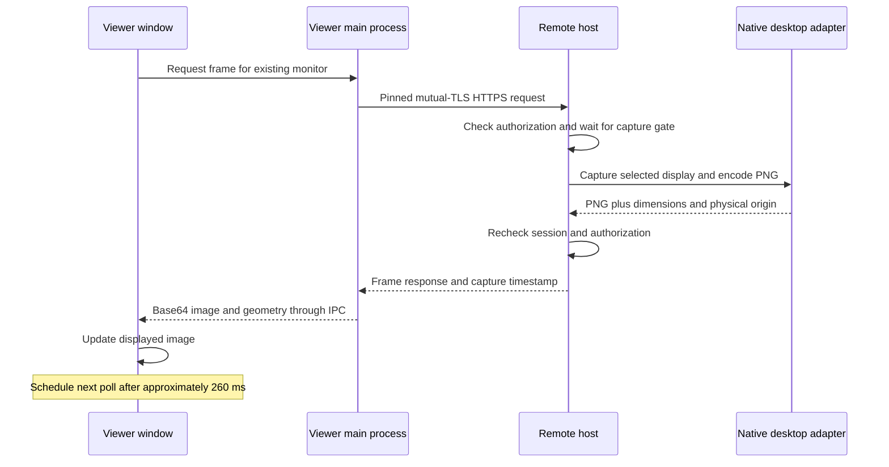

# Orbit Remote performance and streaming plan

The preview uses full PNG screenshots requested over HTTPS. It supports functional desktop viewing and input, but has no verified frame-rate, end-to-end latency, bandwidth, or long-duration resource benchmark. A [loopback frame-cost baseline](#loopback-frame-cost-baseline) records frame sizes and host request times on one Windows machine. Windows capture has been exercised locally. macOS and Linux performance remains unvalidated.

Use this document to understand current costs and collect evidence before choosing optimizations. The [architecture](ARCHITECTURE.md) describes process and trust boundaries; [VALIDATION.md](VALIDATION.md) records completed checks.

## Current frame pipeline



The renderer schedules the next poll with `setTimeout(..., 260)` after the frame request finishes. **260 ms is the configured waiting period, not measured latency or a delivered frame interval.** Request setup, network round trips, host queueing, capture, PNG encoding, response transfer, and local processing add to the time between requests. Browser scheduling and image decoding can add further visible delay.

A useful model for one window is:

```text
next request begins after approximately:
260 ms + previous request setup + network + host queue/capture/encode
       + response transfer + IPC processing

visible update also depends on image decode and presentation scheduling
```

No term here is a measured benchmark. The timeout is a scheduling request rather than a deadline or guarantee. Reducing it alone cannot remove capture, transfer, or decode cost.

## Costs visible in the implementation

| Stage | Current behavior | Implication to measure |
|---|---|---|
| Capture | Full selected-display screenshots, serialized by the host capture gate. | Larger/Retina displays and more viewer windows can increase work and queueing. |
| Compression | PNG encoding; no negotiated video codec, dirty rectangles, or hardware video encoder. | Compression cost and frame size vary with screen content. Scrolling/video can be expensive. |
| Requests | The TLS transport creates a pinned agent per request and destroys it afterward; keepalive is disabled. | Repeated TCP/TLS setup adds work and network trips. A shared authenticated session does not mean one persistent socket. |
| Delivery | PNG bytes become a base64 data URL sent through Electron IPC. | Encoding, extra allocations, IPC, image decode, and garbage collection need profiling. |
| Multiple displays | Viewer windows share one session. Simultaneous requests for the same monitor share an in-flight request; different monitors have independent frame slots. Host capture remains serialized. | More monitors add capture/encode/transfer work. There is no global adaptive capture/bandwidth scheduler. |
| Input | Input has a separate host gate, bounded viewer queues, and coalesced pointer moves. | Capture is not intentionally ahead of input in the same queue, but CPU/network saturation can still affect responsiveness. |

The native sources are [WindowsPlatformBackend.cs](../src/Orbit.Host/Platform/WindowsPlatformBackend.cs), [MacPlatformBackend.cs](../src/Orbit.Host/Platform/MacPlatformBackend.cs), and [LinuxPlatformBackend.cs](../src/Orbit.Host/Platform/LinuxPlatformBackend.cs). Polling lives in [App.tsx](../apps/desktop/renderer/src/App.tsx); transport setup is in [transport.cjs](../apps/desktop/electron/transport.cjs). These are implementation facts, not evidence of native performance parity.

## Loopback frame-cost baseline

The frame route accepts an optional `scale` (0.33 to 1, box-averaged, still PNG) and one `If-None-Match` validator. If the visible pixels have not changed, it answers `304 Not Modified` with no body. The block below is generated by [scripts/perf/measure-frames.mjs](../scripts/perf/measure-frames.mjs) against the real host in `--loopback-test` mode. It records frame size and host-side request cost on one machine. It is not a network, latency, or frame-rate benchmark. Regenerate it with `node scripts/perf/measure-frames.mjs --write`; edits inside the markers are overwritten.

<!-- perf:start -->
Measured 2026-10-26 with `node scripts/perf/measure-frames.mjs` (see [scripts/perf/README.md](../scripts/perf/README.md)).

- Machine: Windows 11 Pro x64, Intel(R) Core(TM) Ultra 7 265F, 20 logical processors
- Display: 3024×1898 captured (session default display; primary display 3024×1898, 1 display attached)
- Host: commit `d7d264f`, Release build
- Method: 30 timed requests per mode after 2 discarded warm-up requests, 260 ms pause between requests (the viewer's poll delay), view-only session, one new pinned mutual-TLS connection per request (as the viewer does today).

| Mode | Requests | 304 ratio | Encoded size | Body bytes median | Body bytes p95 | Request ms median | Request ms p95 | Median body at 2 Mbit/s |
|---|---|---|---|---|---|---|---|---|
| Full scale, no validator | 30 | 0/30 | 3024×1898 | 996.0 KiB | 1009.1 KiB | 148.1 | 181.0 | 4.08 s |
| Full scale, If-None-Match | 30 | 0/30 | 3024×1898 | 992.4 KiB | 996.6 KiB | 145.6 | 176.5 | 4.06 s |
| Scale 0.75, no validator | 30 | 0/30 | 2268×1424 | 706.1 KiB | 710.5 KiB | 204.4 | 228.9 | 2.89 s |
| Scale 0.5, no validator | 30 | 0/30 | 1512×949 | 380.8 KiB | 403.5 KiB | 168.4 | 191.3 | 1.56 s |

No 304 responses in this run: the screen changed between every poll (for example an animated terminal, clock or cursor), so this run did not observe idle-screen savings. Same-pixel 304 behaviour is covered by the host unit checks in `tests/Orbit.Host.Tests/FrameQualityChecks.cs`.

Caveats:

- Loopback only. Request time covers TLS setup, host capture, hashing, scaling and PNG encoding, and local transfer. It excludes real network latency, bandwidth limits, DERP relays, Electron IPC, base64 conversion and image decode.
- "Body bytes" counts the HTTP response body only (a 304 has none); headers and TLS overhead are not included. The 2 Mbit/s column is arithmetic, not a measurement.
- The 304 ratio depends on screen activity during the run: a clock, cursor blink or animation changes the pixels and forces a full frame. PNG sizes depend on what was on screen. Screen content was not controlled.
- One machine, one run. No Mac, Linux, multi-monitor or real-network result follows from these numbers.
<!-- perf:end -->

## Frame-path work since the baseline (2026-10-26)

Frame rate is the top priority. Each row was measured on one Windows 11 PC (Intel Core Ultra 7 265F, RTX 5060 Ti, 3024×1898 display) unless it says otherwise. Samples are small and screen content was not controlled; treat these as direction, not guarantees. "Next release" changes are verified in development and are not in preview.4; "in development" parts are measured on their own and not yet connected to the app.

**Real cross-device baseline (preview.4, Tailscale relayed, view-only, 30 frames):** Mac viewing Windows, median 1.86 s / p95 2.69 s per frame (~940 KB PNG, TLS 1.3); Windows viewing Mac, 1.77 s / 6.16 s (~1.36 MB Retina PNG, TLS 1.2). This predates every change below. See [VALIDATION.md](VALIDATION.md).

| Change | Status | What it fixes | Measured effect |
|---|---|---|---|
| Connection reuse | Next release | A pinned mutual-TLS handshake for every frame | ~1.2 s of handshake round trips per frame removed at 150 ms RTT (estimated from a throttled run; the certificate pin is still checked on every new connection) |
| Binary frames on a canvas, no fixed 260 ms pause | Next release | Stop-and-wait polling, base64 over IPC | Viewer updates 2.0 → 3.75 per second on loopback (~1.85×); request time unchanged (~220 ms), so the host became the bottleneck |
| Smaller of PNG or JPEG per frame | Next release | ~1 MB PNG per frame | Full-scale 1044 → 497 KiB. Through a 2 Mbit/s, +150 ms, 1 % loss proxy: 5.2 → 2.5 s per full frame, 1.2 s at half scale. Text-heavy frames still choose lossless PNG |
| DXGI GPU capture | Next release (beta) | GDI BitBlt of the whole desktop | Changed frame 4.4 ms vs 62 ms BitBlt (155 ms for today's full capture path with cursor and PNG); "unchanged" check ~0 ms |
| Hardware H.264 encode (Media Foundation) | Next release (beta) | A full image per update | NVIDIA encoder, Release build: 1080p 2.5–2.9 ms median per frame, 3024×1898 5.8–7.6 ms; updates of 2–26 KB (vs ~1 MB PNG); no frames of encoder delay (synthetic content) |
| WebCodecs hardware decode in the viewer | Next release (beta) | — | 0.5–0.7 ms median on Windows at 1080p and 3024×1898; 2.4–3.3 ms on an Apple-silicon Mac; 60 and 120 fps with no dropped frames; canvas draw 0.2 ms (synthetic content) |
| Per-frame session check | Next release | Each capture re-read this process's Windows session id through a new Process object (~9.6 ms, twice per check, several checks per frame) | Live capture 133 → 2.3 ms median; every lock-screen and desktop check still runs on each frame |
| Stream pacing and 2:1 downscale | Next release | Frames scheduled after encode start; 15.6 ms timer rounding; slow scaler | Offline stream loop 36–52 → 60 fps, real NVIDIA encoder included |
| **Live video stream, end to end** | Next release (beta) | — | **59.3 frames/s at native 2560×1440** (1,780 frames in 30 s; sequential run, real app over pinned loopback mTLS), decode 0.6 ms median / 1.5 ms p95, about 300 KB/s. The picture path on the same screen: about 20.8 frames/s at 12.5 MB/s |

**Per-frame budget for the stream at 3024×1898:** capture 4.4 + encode 5.8–7.6 + decode 0.5–0.7 + draw 0.2 ≈ **11–13 ms plus network, IPC and queueing** (lower at 1080p). This is a sum of separate measurements, not an end-to-end result; an end-to-end measurement must confirm it before any latency claim. Targets, set against published figures from leading tools: 1080p60 on a LAN; ≤ 10–16 ms added LAN latency (Parsec reports 7 ms); at 1 % loss no freeze longer than 100 ms; text as sharp as 4:4:4.

The frame benchmark (`scripts/perf/measure-frames.mjs`, with `--format` and `--throttle`) and the WebCodecs decode benchmark ship with the next release.

## Tailscale path matters

A direct Tailscale path generally offers lower latency and more throughput than DERP relay traffic. Peer relay is another possible path. A connection may change paths, so record the actual path during each run rather than assuming that a successful pairing means a direct connection. [Tailscale connection types](https://tailscale.com/docs/reference/connection-types)

While the devices communicate, inspect:

```bash
tailscale status
tailscale ping <peer-tailscale-ip>
```

Record `direct`, DERP `relay`, or `peer-relay` as reported, together with network location and round-trip observations. Keep raw diagnostic output private if it identifies devices or users. Tailscale's status/ping commands help distinguish transport limitations from application work; they do not measure Orbit's capture-to-screen latency. [Tailscale path diagnostics](https://tailscale.com/docs/reference/connection-types#determine-your-connection-type)

## Repeatable measurement checklist

First establish a Windows-to-Mac or Mac-to-Windows session on real hardware. Use a local recovery route, view-only first, and explicit input approval. Do not include lock, restart, clipboard writes, or file transfers in a passive capture benchmark without deliberately enabling those operations.

1. **Record the environment.** Source commit and build mode; host/viewer OS and architecture; CPU/GPU; power state; monitor pixels, scale, rotation, and layout; OS permissions; Tailscale version/path; approximate available link bandwidth.
2. **Use repeatable screen content.** Idle desktop, text scrolling, dragging a window, and a motion-heavy scene. Record the same actions for every candidate implementation.
3. **Measure stages.** Capture/encode duration, capture-gate wait, encoded bytes, request completion, local decode/presentation, successful update intervals, input response, and disconnect/recovery time. Record host/viewer CPU, memory, and GPU use where available.
4. **Compare one and multiple displays.** Start with one viewer window, then two existing monitors in the same session. Include mixed-DPI and headless/disconnected-display cases where supported. Record skipped/error frames and queue growth.
5. **Test impaired paths.** Include direct and relayed paths, interruptions, sleep/wake, slower bandwidth, and a peer that stops reading. Keep pending work and memory bounded; denial and revocation must still take effect.
6. **Publish distributions and limits.** State sample count, run duration, workload, median/tail values, failure count, and test method. Enter actual observations in [VALIDATION.md](VALIDATION.md); leave unmeasured fields unmeasured.

Use a single monotonic clock for local stage timings. Host capture timestamps and viewer wall-clock times cannot establish one-way latency unless their clocks are synchronized and the synchronization error is stated. For end-to-end input-to-image latency, use an instrumented loop or high-speed recording with a documented method. A local loopback smoke test cannot establish internet, DERP, Mac, or Linux performance.

## Improvement order

1. **Add measurements before tuning.** Stage timings and a bounded, redacted diagnostic summary should reveal whether capture, encoding, network, or presentation dominates.
2. **Improve connection and frame scheduling.** Evaluate a persistent certificate-pinned transport, shared per-monitor capture, bounded frame queues, cancellation, and per-host bandwidth allocation. Preserve immediate authorization checks and revocation on reused connections. Skip unnecessary hidden/minimized views without hiding a failed connection.
3. **Adopt efficient native capture.** Evaluate GPU-backed capture on Windows, ScreenCaptureKit on macOS, and supported portal/PipeWire capture on Wayland. Validate cursor, privacy permissions, display changes, and device-loss recovery independently on each platform.
4. **Negotiate a video path.** Add established codecs, hardware encode/decode where available, congestion adaptation, frame pacing, quality/resolution controls, and a text-oriented mode. Keep a bounded fallback and report the codec/encoder actually in use.
5. **Scale to multiple outputs.** Budget capture/encode work across existing displays and any future virtual outputs. Test independent window focus, display-specific geometry, input release, and session shutdown under load.
6. **Add audio separately.** Audio requires its own capture/transport, permission state, buffering, and synchronization work; there is no audio channel in the preview.

The target is responsive, predictable control with bounded resource use. No delivered FPS or latency target is claimed until a native-device benchmark supports it. Adding a [virtual monitor](VIRTUAL_DISPLAYS.md) creates desktop space only; it does not accelerate the PNG pipeline or provide an additional independent user session.
