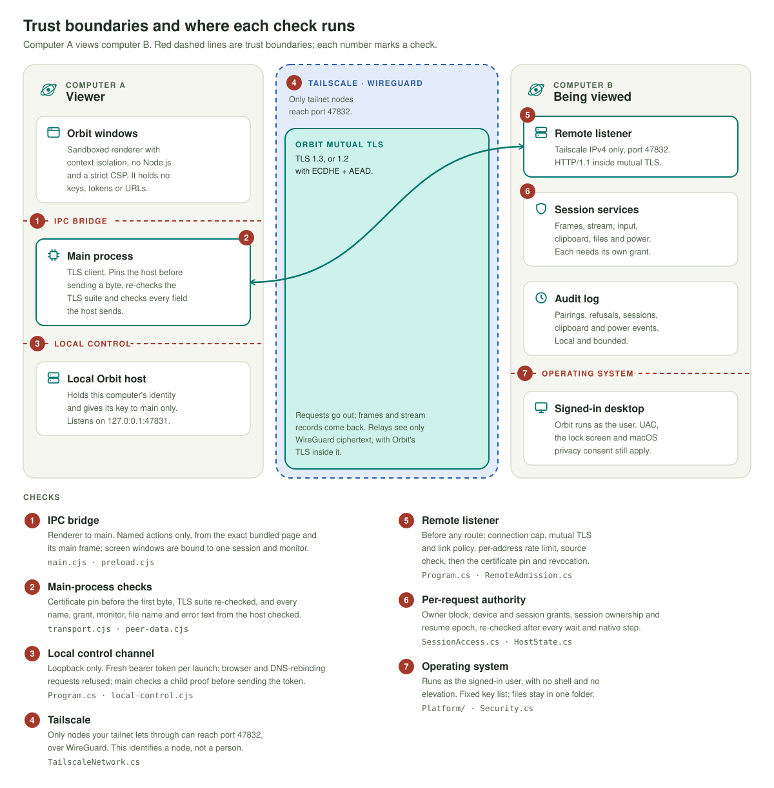
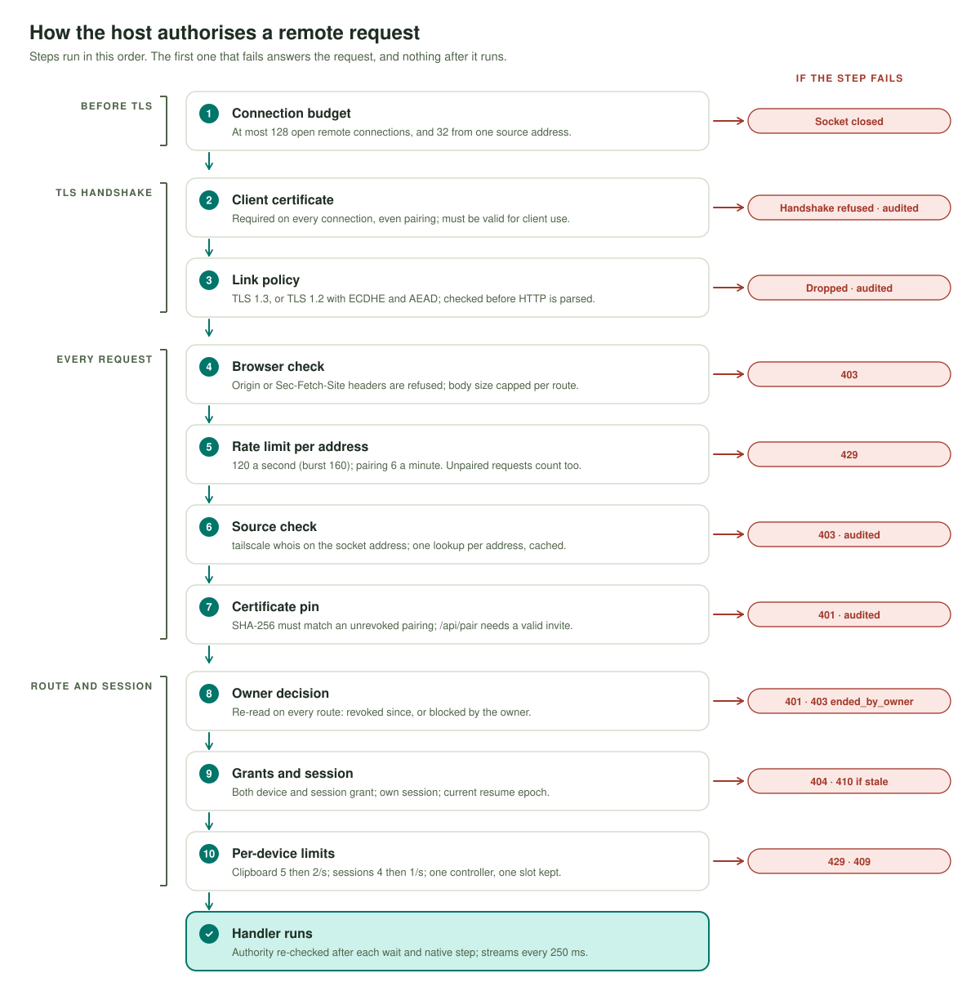

# Orbit Remote security review, October 2026

This report records a security review of Orbit Remote, what it found, what was changed, and what remains. It is written for users who want to judge the risk of running Orbit and for reviewers who want to check the claims against the code. It is not a certification. [SECURITY.md](../SECURITY.md) remains the security model of record.

## Contents

1. [Summary](#1-summary)
2. [System and trust model](#2-system-and-trust-model)
3. [Defences, layer by layer](#3-defences-layer-by-layer)
4. [Findings](#4-findings)
5. [Known limits and accepted risks](#5-known-limits-and-accepted-risks)
6. [Verification](#6-verification)
7. [Reporting a vulnerability](#7-reporting-a-vulnerability)

## 1. Summary

| | |
|---|---|
| **Date** | 28 October 2026 |
| **Product** | Orbit Remote 0.1.0, development preview |
| **Code reviewed** | Main branch at `fe476b5` (findings); fixes verified on main at `52e89b43` |
| **Scope** | The .NET host (`src/Orbit.Host/`): listeners, authentication, pairing, sessions, grants, input, clipboard, files, power, audit, and the disabled short pairing code. The Electron desktop app (`apps/desktop/`): main process, preload bridge, renderer, transport, local control channel, packaging and fuses. Build scripts, npm and NuGet dependencies, repository settings, and secrets in the Git history. |
| **Out of scope** | Tailscale itself, the operating systems, Electron and .NET internals, and physical access. macOS and Linux native backends were read but not exercised on those systems. |

**Result.** No Critical or High findings. Two Medium findings, both in the desktop app, are fixed. The remaining 21 findings are Low (8) or informational (13). Six of the Low findings are fixed, one is a documented limit (H-2, Control versus the Power grant), and one is partly mitigated (H-5, the bundled .NET runtime). The informational items are fixed, documented as limits, accepted, or still open (D-9 and D-10, both about the build process).

**Method.**

1. **Two separate reviews.** One reviewer covered the host and the network protocol; the other covered the desktop app and the supply chain. Each worked read-only in its own checkout, traced every route and IPC action, and checked 53 claims in the existing documentation against the code. They used throwaway probes where reading was not enough, for example Electron 45 probes for debug switches and CSP behaviour, and a Windows probe for reserved device names. No probe touched a real Orbit host or network.
2. **Fixes.** Each finding was fixed, documented or accepted in its own commit, with tests that fail on the old code where a test is possible.
3. **Review of the fixes.** A third, separate review read the fix commits. It found gaps (a clipboard budget that reset with each new session, session churn that could still flush the audit history, a connection cap that also limited the local control listener, and literal invisible characters in source files), and those were fixed in the follow-up commits `be2e2eca`, `7ddc6dac` and `dd400642`.

The reviewers and the developers were AI coding agents working under the maintainer's direction, in separate checkouts and sessions. This is an internal review. No external security firm has audited Orbit.

**Which builds contain the fixes.** Every public release up to and including `v0.1.0-preview.5` was built before these fixes and does not contain them. The fixes ship in the first release built from `52e89b43` or later. Commit IDs in this report refer to the development repository; the public repository receives the same changes in a release export, so its commit IDs differ.

**Severity scale.** *Critical:* remote compromise without credentials. *High:* a remote attacker gains access or a capability it was not granted. *Medium:* a realistic attacker position causes lasting harm or defeats a stated protection. *Low:* a limited or mostly theoretical gain, or one that needs an unusual position. *Info:* hardening, documentation or process.

## 2. System and trust model

Orbit lets one computer (the **viewer**) see and, if allowed, control another (the **host**) over the user's existing Tailscale network. Every installation runs both roles. On each computer there are three processes: the sandboxed Electron windows (renderer), the Electron main process, and a .NET host process. The main process talks to its own host over a loopback control channel. A viewer's main process talks to a remote host over mutual TLS inside Tailscale's WireGuard tunnel. [ARCHITECTURE.md](ARCHITECTURE.md) describes the components in full.

  <picture>
    <source media="(max-width: 767px) and (prefers-color-scheme: dark)" srcset="assets/diagrams/security-boundaries-narrow.svg">
    <source media="(max-width: 767px)" srcset="assets/diagrams/security-boundaries-narrow-light.svg">
    <source media="(prefers-color-scheme: dark)" srcset="assets/diagrams/security-boundaries.svg">
    
  </picture>

*Figure 1. Trust boundaries and the checks at each one. Numbers match the list under the figure and the sections in [Defences](#3-defences-layer-by-layer).*

### Assets

| Asset | Where it lives | Why it matters |
|---|---|---|
| Screen content | Captured on the host, sent as H.264 video or PNG/JPEG images | Shows anything on the user's desktop, including passwords being typed and private documents |
| Input control | Host input backend (`SendInput`, CoreGraphics, `xdotool`) | Control of keyboard and mouse is control of the user's account |
| Files | One owner-chosen transfer folder on the host; user-chosen paths on the viewer | Uploaded files can be opened by the user; downloads land on the viewer |
| Clipboard | Host clipboard, read and written on request | Often holds passwords, one-time codes and payment details |
| Identity keys | RSA-3072 key per installation: Windows DPAPI, or a user-only file on macOS and Linux | Possession of a paired key is possession of that device's access |
| Pairing invitations | Shown in the host app; host keeps only a hash in memory | An invitation is a bearer secret for five minutes |
| Local control token | Random per launch, held by the main process and its host child | Grants full local administration of the host process |
| Audit history | `audit.jsonl` in the host data folder | The owner's record of pairings, refusals and remote actions |

### Attacker positions

| Position | Can | Cannot |
|---|---|---|
| **Tailnet peer without an invite** (any node your Tailscale ACLs let reach the host, including shared-in nodes and LAN devices behind a subnet router) | Reach port 47832 and complete a TLS handshake with any self-signed client certificate. Attempt pairing at 6 tries per minute against a 256-bit secret. Use pre-authentication resources up to the connection and rate limits. | Pair without the invitation secret. Reach any route other than pairing. See any screen, file or setting. |
| **Paired peer with limited grants** | Use exactly the grants the owner chose. Hold up to 2 sessions and use bounded host resources. | Use a grant it lacks: every route checks the device grant and the session grant on every request. Keep access after revocation (requests fail at once, open streams end within 1 s). Push out the owner's controller (one session slot is kept for control). |
| **Malicious paired host, as seen by the viewer** (for example the sender of a hostile invitation) | Show any picture it likes, send hostile names, file listings and error text, and offer files for download. | Reach the viewer's computer: viewing is one-directional, and the host would need its own invitation from the viewer's owner. Run code in the viewer: no HTML sinks, a validated stream parser, sanitised peer data. Make a downloaded file skip Mark-of-the-Web or quarantine. |
| **Another local user** on a multi-user computer | Connect to the loopback control port and the Tailscale listener. | Use the control channel without the per-launch token. Pair or reach routes without an invitation or a paired key. Read the identity key (DPAPI per user; mode 0600 files). |
| **Malware running as the same user** | Read the identity key and the control token, drive the desktop directly, and act as Orbit. This position is outside Orbit's trust boundary. | Relaunch an installed release with Chromium debugging or sandbox-weakening switches, or inject Node options: these are refused before any window opens. This raises cost; it does not contain such malware. |
| **A website the user visits** | Send requests to `127.0.0.1` and to tailnet addresses from the user's browser. | Use either listener: requests with `Origin` or `Sec-Fetch-Site` headers are refused, the local listener requires a bearer token and the exact `127.0.0.1` Host header (DNS rebinding fails), and the remote listener requires a paired client certificate. Inject invitations: Orbit registers no `orbit://` protocol handler. |
| **A compromised dependency** | Run with the rights of the process that loads it. | Escape the renderer sandbox if it lives only in the renderer (React and the icon set). Main-process and host dependencies have no such containment; exact pins, lock files and audits reduce the chance, not the impact. |

  <picture>
    <source media="(max-width: 767px) and (prefers-color-scheme: dark)" srcset="assets/diagrams/security-attackers-narrow.svg">
    <source media="(max-width: 767px)" srcset="assets/diagrams/security-attackers-narrow-light.svg">
    <source media="(prefers-color-scheme: dark)" srcset="assets/diagrams/security-attackers.svg">
    
  </picture>

*Figure 2. Who is stopped where. A filled circle means the defence stops that attacker, a half circle that it limits it, an empty circle that the attacker passes it, and a dash that it does not apply.*

## 3. Defences, layer by layer

Paths are relative to the repository root. Host files are in `src/Orbit.Host/`; desktop files are in `apps/desktop/`.

### Tailscale and WireGuard

The remote listener binds only the Tailscale IPv4 address that `tailscale status --json` reports, in `100.64.0.0/10`. There is no all-interface, LAN or public listener, and if Tailscale is unavailable no remote listener opens (`TailscaleNetwork.cs`, `Program.cs`). Traffic between nodes is encrypted by WireGuard. Tailscale decides which nodes can reach the port; Orbit does not add ACLs of its own.

### Source check

Every remote request's source address is read from the socket, never from a header, and checked with `tailscale whois --json <address>`, run with a fixed argument list and no shell. Concurrent requests from one address share a single lookup. A verified address is cached for 10 s and a refused one for 3 s (`RemoteSourceVerifier` in `RemoteAdmission.cs`). A refused source gets `403` and an `auth.source_rejected` audit entry. The check proves that the request came from *some* node the tailnet lets reach this computer. It does not identify a user or device (H-6).

### Mutual TLS with pinning on every request

- **Admission before TLS.** At most 128 open remote connections, and 32 from one source address, counted before the handshake (`ConnectionBudget` in `RemoteAdmission.cs`). The remote listener speaks HTTP/1.1 only, so one connection carries one request at a time.
- **Handshake.** A client certificate is required on every connection, including pairing (`ClientCertificateMode.RequireCertificate`, `Program.cs`). It must be current, strong, and marked for client authentication (`Security.IsClientCertificateUsable`).
- **Link policy.** TLS 1.3, or TLS 1.2 with ECDHE and AEAD only. The host checks the negotiated suite after the handshake and before parsing HTTP (`Security.IsStrongTls`); the viewer offers only those suites and re-checks them (`describeLink` in `electron/transport.cjs`). [ENCRYPTION.md](ENCRYPTION.md) lists the suites and the measurements.
- **Viewer pins first.** The viewer's `PinnedAgent` (`electron/transport.cjs`) releases the socket only after the host certificate's SHA-256 matches the pin and the link passes policy, so no request byte, and no invitation secret, reaches an unverified peer.
- **Host pins every request.** Middleware in `Program.cs` hashes the presented certificate on every request and looks it up among pairings that are not revoked (`HostState.FindDevice`). An unknown or revoked certificate gets `401` and an `auth.unknown_certificate` audit entry. A device ID in a request never authorises anything.
- **Rate limit.** A per-address token bucket (120 requests a second, burst 160) and a pairing limit (6 a minute) run *before* the certificate, source and pin checks, so rejected and unauthenticated traffic is counted too.

  <picture>
    <source media="(max-width: 767px) and (prefers-color-scheme: dark)" srcset="assets/diagrams/security-request-path-narrow.svg">
    <source media="(max-width: 767px)" srcset="assets/diagrams/security-request-path-narrow-light.svg">
    <source media="(prefers-color-scheme: dark)" srcset="assets/diagrams/security-request-path.svg">
    
  </picture>

*Figure 3. The order in which the host checks a remote request, and the answer when a step fails. The per-address rate limit runs before authentication; the per-device limits run after the grant check.*

### Pairing and invitations

- An invitation carries the host address, the host certificate fingerprint and a 256-bit random secret (`Security.RandomToken`). It lasts five minutes, works once, and at most 20 are active. The host keeps only the secret's SHA-256 in memory, and unused invitations disappear when the host restarts (`HostState.cs`).
- Consumption is atomic: the hash is removed before the expiry check, and if saving the new pairing fails, the in-memory device list is restored, so the certificate is not trusted until the next restart either.
- The viewer checks the address (Tailscale literal only), format, size and expiry of an invitation before connecting (`electron/transport.cjs`), and sends the secret only over a pinned connection.
- A refused pairing is audited as `pair.rejected`, with the source address and a fixed reason, never the secret.
- Re-pairing does not clear an owner block. Invitations that grant Power without Control are refused.
- Both computers show a 128-bit **security code** from the certificate fingerprints. Comparing it once detects an invitation that was intercepted and redeemed by someone else.
- **Short pairing code (F33).** An experimental SRP-6a short-code path exists in the host but is off unless `ORBIT_EXPERIMENTAL_SHORT_CODE=1` is set, and the installed app strips that variable from its host's environment (`electron/host-environment.cjs`). Two earlier reviews found it safe to merge disabled and not ready to enable; this review found nothing new. Enabling it is blocked on an upstream SRP blinding fix in the pinned Bouncy Castle release and on a review of the full protocol composition. See [RESULTS.md](RESULTS.md) and [PROTOCOL.md](PROTOCOL.md#short-pairing-code-experimental-disabled-by-default).

### Grants and per-request authority

- Grants are View, Control, Clipboard, Files and Power, chosen per paired device by the host owner. New invitations default to view only.
- Every session route goes through `SessionAccess.FindSession` (`SessionAccess.cs`). It re-reads the current pairing for the presented certificate (revoked: `401`; blocked by the owner: `403 ended_by_owner`), requires the grant on both the device and the session, requires that the session belongs to this device, and requires the current resume epoch (`410` if stale).
- **View-only enforcement.** A view-only session is created with Control, Clipboard, Files and Power removed (`HostState.StartSession`), so a device allowed to control still cannot send input, use the clipboard, transfer files or use power actions in a view-only session.
- **Re-checks.** Authority is checked again after every queued wait and after every native read, capture or write: clipboard, power, each input event, each frame, each upload chunk with a final check under the state lock, and each download chunk. Open video streams re-check every 250 ms and end within 1 s of revocation (`VideoStreamRun.cs`).
- **Per-device limits.** Clipboard reads and writes share one bucket per device (5, then 2 a second) and return `429 clipboard_rate_limited`; new sessions are limited per device (4, then 1 a second) with `429 session_rate_limited` (`DeviceRateLimiter.cs`). There is one controller at a time, at most 2 sessions per device and 8 per host, and viewing sessions may hold at most 7 of the 8 slots.
- **Power.** Orbit's lock and restart actions need the Power and Control grants on the session and the host's local opt-in, and are audited. They do not limit what a controller can do through the desktop UI; see [Known limits](#5-known-limits-and-accepted-risks).
- **Audit.** Remote pairings, refusals, sessions, clipboard operations (byte count only), file transfers and power actions are written to a bounded, append-only local log that rotates at 256 KiB. Repeated remote session and clipboard events are coalesced per device per minute, and refusal entries per source per minute with a host-wide budget, so a peer cannot flush the history. The log is local and not tamper-evident.

### Input safety

Input is a fixed set of typed events mapped through a static key allow-list; there is no command-execution API and no shell anywhere in the host (`Platform/WindowsPlatformBackend.cs`; Linux uses `xdotool` with an argument list and `--`). Pointer coordinates must fall on a reported monitor and wheel deltas are bounded. Batches carry 1 to 64 events, each re-checked before it is applied. Held keys and buttons have a 10 s lease, a safety worker releases expired leases every 2 s, and the host stops if that worker fails (`InputLeases.cs`). Revoke, Block, End and host shutdown release held input. The viewer must also choose **Take control** before it sends input.

### File transfer

- **One folder.** Remote file access is confined to one owner-chosen, existing, absolute directory that is not a disk root.
- **Name checks.** File names are checked by `Security.ValidateFileName`. It refuses separators, control characters, `..`, trailing dots and spaces, names over 180 characters, and Windows device names including `COM0`, `LPT0`, superscript forms, `CONIN$`, `CONOUT$` and `CLOCK$` (H-10).
- **Path checks.** Reparse points anywhere up the ancestor chain and Windows short-name aliases are refused.
- **Uploads.** At most 32 MiB each, written create-new under a reserved staging prefix, marked with `Zone.Identifier` ZoneId=3 and verified, then published without overwriting (`UploadStore.cs`, `UploadMetadata.cs`). An upload is refused unless the folder's volume keeps 1 GiB free after every in-flight upload (H-4).
- **Downloads.** At most 32 MiB, with authority re-checked per chunk; losing authority aborts the transfer.
- **Viewer side.** The viewer drops remote names containing bidi, format or control characters, Windows-invalid characters, trailing dots or spaces, or reserved device names, and refuses to download them (`electron/peer-data.cjs`, D-4). Saved files get Mark-of-the-Web on Windows and the quarantine attribute on macOS (`electron/mark-of-web.cjs`), and paths come only from native dialogs opened by the main process.

### Local control channel

The main process administers its own host over HTTP on `127.0.0.1:47831`. The host accepts a local request only if it comes from a loopback address with `Host: 127.0.0.1` (which defeats DNS rebinding), carries no `Origin` or `Sec-Fetch-Site` header, and presents the per-launch bearer token, compared in constant time (`Program.cs`, `Security.TokenEquals`). The token is 32 random bytes generated by the main process at each launch and passed to the child in its environment. Before sending the token, the main process verifies an HMAC proof bound to the child's PID, the port and the client socket's own source port, keyed by a secret sent over the child's stdin (`electron/local-control.cjs`, `ParentProof.cs`). A process squatting the port therefore cannot obtain the token; it can only deny service. An installed release ignores `ORBIT_CONTROL_PORT` and always uses the default port.

### Electron hardening and IPC

- **Windows.** Both window types use `contextIsolation`, `sandbox`, `nodeIntegration: false` and `webSecurity`, and DevTools are disabled in release builds (`electron/main.cjs`). Navigation, new windows and `<webview>` are refused, and every web permission request is denied.
- **Content.** A strict content security policy is set as a response header. The renderer has no HTML-string sinks (`innerHTML`, `dangerouslySetInnerHTML`, `eval`), and remote screens arrive as video or images, never as HTML.
- **IPC.** The preload exposes one channel, `orbit:invoke`, with a named-action allow-list (`electron/preload.cjs`). Main accepts a call only from the exact bundled page URL and its main frame, binds screen windows to one session and monitor, and caps payloads at 1 MiB (`electron/main.cjs`). The renderer never receives keys, the control token, URLs or file-system paths.
- **Transfer folder.** It comes only from main's native folder dialog. A folder sent by the renderer is ignored (D-3).
- **Untrusted host data.** Everything a paired host sends (name, platform, grants, monitors, file listings, clipboard text, error text) passes through one sanitiser in main, `electron/peer-data.cjs`. It enforces type and length and the same display-name rule as the host, and it also repairs `connections.json` on load. A root React error boundary (`renderer/src/ui/ErrorBoundary.tsx`) turns any value the UI cannot draw into a recoverable error screen (D-1).
- **Stream parser.** Stream records are validated before allocation: type, flags, sequence, length per type, configuration bounds, and a keyframe flag that must match the H.264 NAL slice types (`electron/stream-parser.cjs`).

### Packaging fuses and launch policy

- **Fuses.** Release packages set Electron fuses that turn off `ELECTRON_RUN_AS_NODE`, `NODE_OPTIONS` and Node's `--inspect`, and load app code only from an integrity-checked `app.asar` (`electron-builder.cjs`).
- **Launch policy.** Fuses do not cover Chromium's own switches, so `electron/launch-policy.cjs` checks `process.argv` and `app.commandLine` before any window, profile lock or host start. It refuses remote debugging, inspector, sandbox-weakening, feature-override and child-launcher switches, and shows a dialog naming the refused switch. Test variables (`ORBIT_LOOPBACK_TEST`, `ORBIT_APP_DATA`, `ORBIT_CONTROL_PORT`) are ignored, and the host child inherits no `ORBIT_*` variable (D-2, D-5).
- **Test build.** A separate, unfused end-to-end test build carries a marker that the release build cannot gain, because asar integrity is checked. Both release build scripts refuse to produce it (D-8).
- **Remaining gaps.** Two exceptions remain: the Linux AppImage `--no-sandbox` case and the `file://` fuse. Both are covered in [Known limits](#5-known-limits-and-accepted-risks).

### Supply chain

- **npm.** The desktop app has three runtime npm dependencies (React, React DOM, lucide-react), pinned to exact versions. `package-lock.json` (lockfile v3) records integrity hashes for every package, all from `registry.npmjs.org`. npm 11 blocks dependency install scripts unless they are approved.
- **NuGet.** The host has one NuGet dependency, `BouncyCastle.Cryptography`, pinned to `[2.7.0]` with a content hash in `packages.lock.json`. Release scripts restore it with `--locked-mode`, but the per-platform restore is not hash-locked (D-10).
- **.NET runtime.** The release host is self-contained, so it carries the runtime of the SDK that built it. `global.json` now requires SDK 10.0.403, which bundles runtime 10.0.14 (H-5).
- **Monitoring.** Dependabot alerts are on for both repositories. There is no CI and no branch protection yet (D-9).

## 4. Findings

Status values: **Fixed** (a code change with tests), **Documented limit** (behaviour kept and stated in SECURITY.md or PROTOCOL.md), **Accepted** (kept, with the reason given), **Open** (still to do).

| ID | Title | Severity | Attacker position | Status | Note |
|---|---|---|---|---|---|
| D-1 | Paired-host data stored and rendered without type, length or character checks | **Medium** | Malicious paired host | Fixed in `27539c02`, `dd400642` | One main-process sanitiser for all host fields; `connections.json` repaired on load; root error boundary |
| D-2 | Packaged app honoured Chromium debug and sandbox switches | **Medium** (macOS), Low (Windows, Linux) | Malware running as the user | Fixed in `5e32e10b`, `dd400642` | Refused before any window; DevTools off in releases; AppImage `--no-sandbox` exception |
| D-3 | `settings.update` accepted a renderer-supplied transfer folder | Low | Compromised renderer | Fixed in `417fc90b` | Folder only from main's native dialog |
| D-4 | Remote file names could contain bidi and format characters | Low | Malicious paired host | Fixed in `27539c02`, `dd400642` | Such names are dropped from listings and refused for download |
| D-5 | Test variables honoured by the installed app | Low | Same-user process | Fixed in `5e32e10b` | Release ignores test variables; host child gets no `ORBIT_*` |
| H-1 | Clipboard grant allowed silent, unaudited, high-rate access | Low | Paired peer with the clipboard grant | Fixed in `0be6b5f4`, `be2e2eca` | Per-device budget; reads and writes audited by byte count |
| H-2 | Power grant is not a boundary against a controller | Low | Paired peer with Control | Documented limit (`514b4cdf`) | Control can lock or restart through the desktop UI |
| H-3 | Unbounded pre-authentication work | Low | Tailnet peer without an invite | Fixed in `e392ae4e`, `be2e2eca`, `7ddc6dac` | Connection caps, single-flight whois, rate limit before auth, HTTP/1.1 only |
| H-4 | Paired-peer resource exhaustion (disk, audit, session slots) | Low | Paired peer | Fixed in `917f56a2`, `be2e2eca` | Free-space floor, append-only audit with coalescing, control slot, session rate limit |
| H-5 | Bundled .NET runtime freshness not enforced | Low (applicability unconfirmed) | Tailnet peer | Partly mitigated in `ca876797` | SDK pin moves the runtime to 10.0.14; no automatic freshness gate |
| H-6 | Source check identifies a tailnet node, not a user or device | Info | Tailnet peer | Documented limit (`514b4cdf`) | Keep invitations private; use Tailscale ACLs |
| H-7 | A blocked device could still read `/api/info` | Info | Blocked paired peer | Fixed in `6ab79532` | Same typed `403 ended_by_owner` as session routes |
| H-8 | Failed pairing and unknown-certificate probes not audited | Info | Tailnet peer without an invite | Fixed in `2cb0de74`, `be2e2eca` | Four refusal kinds audited, coalesced, no secrets |
| H-9 | Native and tool error text reflected to peers | Info | Paired peer | Fixed in `7eae104f` | Fixed messages remotely; detail logged locally |
| H-10 | Windows reserved-name list incomplete | Info | Paired peer with the files grant | Fixed in `b50afc8c` | All device names and trailing-space stems refused |
| H-11 | No host-side confirmation or notice for remote restart or lock | Info | Paired peer with Control and Power | Documented limit (`514b4cdf`) | Remote power is off by default; the action is audited |
| H-12 | `ORBIT_LOOPBACK_TEST` honoured by packaged builds | Info | Same-user process | Fixed in `5e32e10b` | Same fix as D-5 |
| H-13 | Temporary Windows key container may outlive a crashed host | Info (not reproduced) | Malware running as the user | Accepted | Stays DPAPI-protected for the same user; no new capability |
| D-6 | CSP `'self'` on `file://` admits any local script; file-protocol fuse on | Info | Needs HTML injection first (none found) | Documented limit (`890a1781`) | Needs a custom protocol; guard test added |
| D-7 | Old public previews shipped without fuses | Info | Same-user process | Accepted | preview.2 to .4 marked Outdated on GitHub; preview.1 no longer listed |
| D-8 | `build.ps1` did not refuse the unfused test build | Info | Release-process error | Fixed in `c41a0e2d` | Matches `build.sh` |
| D-9 | No branch protection, Dependabot or CI | Info | Compromised dependency or bad push | Open (partly addressed) | Dependabot alerts now on; no branch protection or CI |
| D-10 | Per-platform publish restore not hash-locked | Info | Compromised package feed | Open | Package signatures still verified by the SDK |

### Medium findings

**D-1. Paired-host data was stored and rendered unchecked.** The viewer trusted the JSON a paired host returned. A modified host could send an object where a name belongs, an oversized string, or bidi characters. The object was saved to `connections.json`, and on every later launch React threw while drawing it and the window stayed blank, so the owner could no longer manage devices from the GUI. A string could also make one device impersonate the name of another (the security code still differed). *Fix:* `electron/peer-data.cjs` is now the single gate for every field a host sends: names (1 to 80 characters, the host's display-name rule), platform (Windows, macOS, Linux or unknown), grants (booleans), monitors, file listings, clipboard text, and error text (cut to 500 characters, unsafe characters replaced). It also repairs `connections.json` on load and rewrites it only if the repair changed something. A root React error boundary turns any value the UI cannot draw into a recoverable screen. *Tests:* `electron/peer-data.test.cjs` covers object, oversized and bidi names on pairing and refresh, repair on load, monitor type checks, bounded error text on both stream paths, and a round trip of every saved field. An internal UI lab test shows an object host name producing the recoverable screen, and **Try again** recovering.

**D-2. The packaged app accepted Chromium debugging switches.** Electron fuses disable Node's inspector and `NODE_OPTIONS`, but not Chromium switches such as `--remote-debugging-port` or `--no-sandbox`. A probe confirmed that Electron 45 opens a debugging endpoint when given that switch. Malware running as the user could relaunch Orbit with it, attach, and drive Orbit's IPC, for example to create an invitation. On macOS that matters, because Orbit holds the Screen Recording and Accessibility grants the malware itself lacks; on Windows and Linux such malware gains little it did not have, hence Low there. *Fix:* `electron/launch-policy.cjs` refuses debugging, inspector, sandbox-weakening, feature-override and child-launcher switches in every accepted spelling, before any window, profile lock or host start, and shows a dialog naming the switch. DevTools are disabled in release windows. On Linux, an AppImage may start with `--no-sandbox` with a logged and displayed warning (see [Known limits](#5-known-limits-and-accepted-risks)). *Tests:* `electron/launch-policy.test.cjs` covers refusal of each switch form, the AppImage exception and its warning, DevTools off in both window types, acceptance of ordinary launches, and that main applies the policy before any window, lock or host start. A packaged smoke test that launches with `--remote-debugging-port` was not run for this revision.

### Low findings

**H-1. Clipboard access was silent and fast.** A device with the clipboard grant could read the host clipboard several times a second with no audit entry, and so capture passwords and one-time codes the local user copied, or swap a copied payment address just before it was pasted. *Fix:* clipboard routes moved to `ClipboardEndpoints.cs`. One token bucket per paired device, shared by all its sessions so ending and starting sessions does not refill it, allows a burst of 5 and then 2 a second. Excess requests get `429 clipboard_rate_limited` before the native clipboard is touched. Every read and write is audited as `clipboard.read` or `clipboard.write` with the byte count only, coalesced per device per minute. SECURITY.md now says the grant covers both reading and writing. *Tests:* `tests/Orbit.Host.Tests/ClipboardChecks.cs`, including "a rate-limited read never reaches the native clipboard" and "ending and starting a session does not reset the clipboard budget".

**H-2. The Power grant does not limit a controller.** `/power` correctly requires Power, Control and the host's opt-in, but a device with Control can press Win+L or use the Start menu to restart, like any person at the keyboard. *Resolution:* documented. SECURITY.md states that Control is full keyboard and mouse control and that Power governs only Orbit's dedicated lock and restart actions. Dropping individual key chords would not help, because the desktop UI offers the same actions.

**H-3. Pre-authentication work was unbounded.** Any client that could reach the port got a full TLS handshake, with no connection limit. Each request that missed the source-check cache started its own `tailscale whois` process, failures were not cached, and the rate limiter ran only after authentication. A tailnet peer without an invite could therefore spike host CPU and degrade legitimate streams. *Fix:*
- Admission before TLS: 128 remote connections in total and 32 per source.
- One shared `whois` per address, with successes cached 10 s and failures 3 s.
- The rate limiter moved before the certificate, source and pin checks.
- HTTP/1.1 only on the remote listener.

The review of the fixes found that a server-wide connection cap also limited the loopback control listener, which a local process could use to lock the desktop out of its own host. The cap now applies only to the remote listener. The residual risk is documented in PROTOCOL.md: four hostile source addresses at the per-source limit can hold all 128 slots until their connections time out. *Tests:* `tests/Orbit.Host.Tests/RemoteAdmissionChecks.cs` covers budgets, single-flight `whois` and the failure cache. Live checks in `tests/Orbit.Host.Tests/Program.cs` cover an unpaired flood that receives `429`, sockets over the per-source budget closed before TLS, HTTP/2 never negotiated, and the control listener staying reachable with 140 other loopback sockets open.

**H-4. A paired peer could exhaust host resources.** Uploads had no total limit, so a files-grant peer could fill the disk. Every audit event rewrote the whole log under the state lock, so session churn by a view-only peer stalled other requests and pushed real events out of the 500-entry history. Four view-only devices could also fill all 8 session slots and lock out the owner's controller. *Fix:*
- An upload is refused unless the volume keeps 1 GiB free after every in-flight upload.
- The audit log is append-only and rotates at 256 KiB.
- Remote session and clipboard events are coalesced per device per minute, with the repeat count reported in the next entry.
- Session creation is rate-limited per device.
- Viewing sessions may hold at most 7 of the 8 slots.

*Tests:* `ResourceLimitChecks.cs`, `SessionChurnChecks.cs` and the slot check added in `917f56a2`, including "session churn cannot push earlier events out of the 500-entry history" and "viewing sessions from several devices fill all but one host slot".

**H-5. The bundled .NET runtime could go stale.** Release builds are self-contained, so operating-system and .NET updates never patch an installed Orbit. The SDK pin carried runtime 10.0.4, and .NET 10.0.6 through 10.0.14 are security releases. The reviewers did not confirm that any of those CVEs affects Orbit's configuration. *Fix:* `global.json` requires SDK 10.0.403, which bundles runtime 10.0.14 (released 25 October 2026), so builds fail on older SDKs. *Remaining:* nothing checks freshness automatically. Each release must move the pin when a new servicing release ships. *Verification:* `dotnet --list-runtimes` on the build machine lists `Microsoft.NETCore.App` and `Microsoft.AspNetCore.App` 10.0.14.

**D-3. The renderer could set the file-transfer folder.** SECURITY.md said file paths come only from native dialogs, but `settings.update` also stored a `fileTransferRoot` sent by the renderer. A compromised renderer, which would need another bug first, could point the transfer folder at the Windows Startup folder. A files-grant peer could then add a program that runs at the next sign-in. *Fix:* main ignores the field from IPC. The folder is either the one the host already has or one chosen in main's native dialog when file transfer is turned on. *Tests:* `electron/settings-folder.test.cjs` checks that a renderer-supplied folder can neither set, replace nor clear the folder, and that the normal owner flow still works.

**D-4. Remote file names could disguise their type.** The viewer refused only separators and C0 controls. A malicious host could list `invoice<U+202E>fdp.exe`, which displays as `invoiceexe.pdf`. Mark-of-the-Web still triggered SmartScreen on opening. *Fix:* listings drop, and downloads refuse, names with bidi, format or control characters, Windows-invalid characters, a trailing dot or space, or a reserved device name, using the same rule as the host (including the H-10 additions). *Tests:* `electron/peer-data.test.cjs`: "remote file listings refuse bidi, format and control characters in names", "a download with a spoofed name is refused before the save dialog opens", and "reserved Windows device names match the host rule (H-10)".

**D-5. The installed app honoured test variables.** `ORBIT_LOOPBACK_TEST` put the host into loopback test mode: no Tailscale listener, and a remote listener on `127.0.0.1` that accepts any local source, though a paired certificate was still required. `ORBIT_APP_DATA` and `ORBIT_CONTROL_PORT` moved the profile and control port, and other `ORBIT_*` variables passed through to the host. Setting them requires same-user access, and the effect was mostly self-denial of service. *Fix:* a release build ignores the three variables and its host child inherits no `ORBIT_*` variable in any letter case. This also fixes H-12. *Tests:* `electron/launch-policy.test.cjs`: "a release ignores test variables" and "a release host child inherits no ORBIT_* variable in any letter case".

## 5. Known limits and accepted risks

These are deliberate or not yet addressed. Each is also stated in SECURITY.md or PROTOCOL.md.

- **Control is full desktop control.** A device with the Control grant can do anything the signed-in user can do through the desktop, including locking, restarting or shutting down the computer through the normal UI, with or without the Power grant and the host's remote-power setting. Grant Control only to devices you would let use the computer unattended. (H-2)
- **Any reachable tailnet node can attempt pairing.** The source check proves tailnet reachability, not identity. Your other devices, nodes shared into your tailnet, and LAN devices behind a subnet router can all reach the pairing route. The invitation secret is what stops them, so keep invitations private, and restrict reachability with Tailscale ACLs where other people's nodes can reach the computer. (H-6)
- **No local confirmation for remote restart.** With Control, Power and remote power turned on, a device can lock or restart the host with no prompt, notice or cancel option on the host. Windows restarts after a 15-second grace period, macOS after one minute, and Linux may restart immediately. The action is audited. Remote power is off by default. (H-11)
- **Pre-authentication denial of service.** Four hostile source addresses at the per-source connection limit can hold every remote connection slot until their connections time out. The local control listener is not affected.
- **Unsigned Windows builds.** Windows installers are not code-signed, so Windows cannot verify the publisher. Download only from the project's GitHub releases. Signed builds and signed update metadata are release requirements in SECURITY.md. There is no auto-update mechanism.
- **The `file://` fuse and CSP.** The GUI loads from `file://`, where CSP `'self'` matches any local file. Electron's `GrantFileProtocolExtraPrivileges` fuse also stays on, because the module bundle and its decoder worker do not load without it (an Electron 45 probe left the window empty). Exploiting this would first need HTML injection into the GUI, and none is known: the renderer has no HTML-string sinks. Serving the GUI from a custom protocol would close both gaps. A guard test fails if the fuse is turned off while the window still loads from `file://`. (D-6)
- **Linux AppImage `--no-sandbox`.** Ubuntu 24.04 and later restrict the unprivileged user namespaces that Chromium's sandbox needs, so AppImages usually start only with `--no-sandbox`. When `APPIMAGE` is set on Linux, Orbit accepts that one switch, logs a warning on every launch, and shows it once per profile; its windows then run without the Chromium sandbox. A same-user process can set `APPIMAGE`, so the exception is available to it on Linux. Debugging switches stay refused everywhere. The Debian package installs Chromium's sandbox helper and is the better choice where it can be used.
- **Old previews are not hardened.** Public releases `v0.1.0-preview.2` to `.4` were built before the Electron fuses and are marked **[Outdated]** on GitHub; preview.1 is no longer listed. Releases up to and including preview.5 also predate every fix in this report. (D-7)
- **No branch protection or CI yet.** Dependabot alerts are on for both repositories. Branch protection is not available on the private repository's plan and is not configured on the public one. There is no CI workflow; tests, `npm audit` and locked restores run in the release scripts and by hand. (D-9)
- **The per-platform restore is not hash-locked.** `dotnet restore --locked-mode` verifies the committed lock file without a runtime identifier. The publish step then restores again for the target platform without locked mode. The pinned Bouncy Castle package comes from the already-verified cache, and nuget.org package signatures are checked, but runtime packs are not covered by any lock. (D-10)
- **Same-user malware and administrators are outside the boundary.** They can read Orbit's keys and token and drive the desktop directly. The launch policy only raises the cost of using Orbit itself as the tool.

## 6. Verification

Run on main at `52e89b43` on Windows 11 x64, 28 October 2026, unless noted.

| Check | Result |
|---|---|
| Host security harness: `ORBIT_TEST_SKIP_NATIVE_DESKTOP=1 dotnet run --project tests/Orbit.Host.Tests -c Debug` | **1460 of 1460** checks passed. Five native-desktop checks were skipped by that flag (DXGI capture and four native input-rejection probes). The original review ran 1365 checks; the fixes added the rest. |
| Desktop tests: `npm test` in `apps/desktop` | **696 of 696** passed, none skipped |
| `npm audit` in `apps/desktop`, after `npm ci` | **0 vulnerabilities** |
| `dotnet list package --vulnerable --include-transitive` for `Orbit.Host` | **No vulnerable packages.** The only package is `BouncyCastle.Cryptography` 2.7.0. |
| Bundled runtime | `global.json` requires SDK 10.0.403; `dotnet --list-runtimes` lists `Microsoft.NETCore.App` and `Microsoft.AspNetCore.App` **10.0.14** |
| Secret scan of history: `git log -G` over every commit on main for private-key headers and GitHub, Anthropic, AWS, Slack and Tailscale token formats | Only `apps/desktop/electron/test-fixtures/test-private.pem`, a documented test fixture that is excluded from packages. A separate scan for this project's machine names, addresses and paths found no real identifiers. |
| Documentation claims | **53** claims in SECURITY.md, ENCRYPTION.md, PROTOCOL.md and ARCHITECTURE.md checked against the code by the host reviewer, plus the desktop reviewer's checks of the Electron claims. Contradicted or partial claims became findings (H-1, H-2, H-3, H-6, H-7, H-10, D-1, D-3, D-4, D-5), and the documents were corrected with the fixes. |
| Repository settings, read with `gh api` | Dependabot alerts enabled on both repositories; `main` not protected; private vulnerability reporting not enabled on the public repository (the owner enabled it on 28 October 2026, after the review; see section 7) |

**Not verified.** The following were not verified for this revision:

- reading back the fuses of a package built from `52e89b43`;
- launching a packaged release with `--remote-debugging-port` to see it refuse;
- the macOS and Linux behaviour of the launch policy and the AppImage exception;
- whether the .NET servicing CVEs between 10.0.4 and 10.0.14 affected Orbit's configuration.

## 7. Reporting a vulnerability

Report vulnerabilities privately through GitHub private vulnerability reporting on the public repository: open its **Security** tab and choose **Report a vulnerability** ([report a vulnerability](https://github.com/Optimizer077/orbit-remote/security/advisories/new)). The owner turned it on on 28 October 2026, after this review read the repository settings. Only the maintainer sees the report. [SECURITY.md](../SECURITY.md) has the same instructions.

Please do not open a public issue with details.
